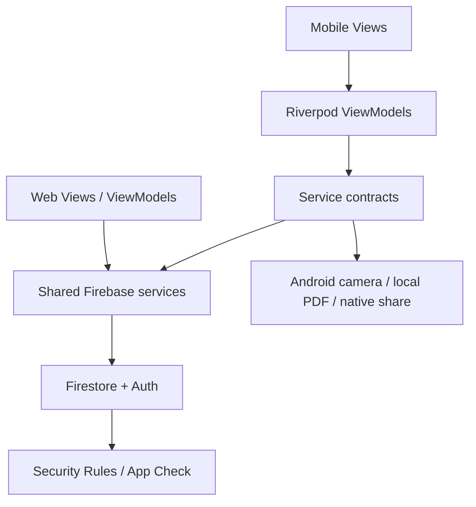
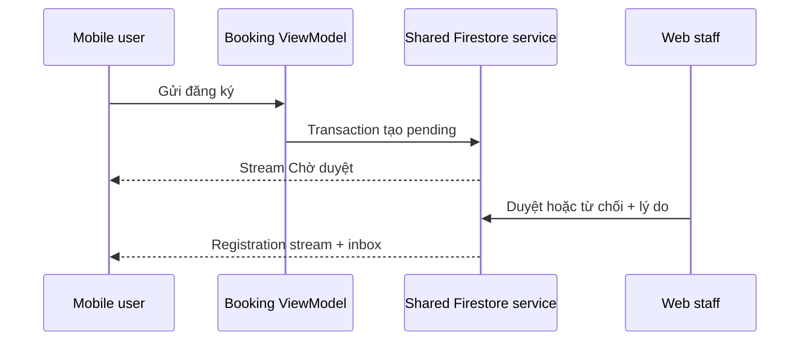

# Kiến trúc Final — cập nhật 13/11/2026

- mobile/lib: Views → Riverpod ViewModels → contracts/services của packages/core. Camera, file PDF và native share là adapter riêng Android.
- web/lib: Views → web ViewModels → cùng packagecore; FirebaseWebAuthService/FirestoreClubService/FirestoreAdminService implementation nằm trong packages/core/lib/services/firebase.
- packages/core/lib: model/status/validation, hợp đồng, services Firestore/Auth, theme, component, font/icon dùng chung. File export tương thích trong mobile và web giữ import cũ mà không sao chép implementation.
- Không custom server, Functions hoặc Storage. Mọi nghiệp vụ ghi Firestore được Security Rules kiểm tra. App Check attestation là cấu hình Console bổ sung, không thay thế Auth/Rules.
- Mobile chỉ mở UID-scoped providers khi role user được xác minh bằng stream Firestore. Role đổi hoặc logout làm reset private state; camera chỉ chạy cho đăng ký được duyệt.
- Inbox kết hợp thông báo riêng, announcements và receipts; lọc scope theo current registrations; stream errors hiển thị retry.
- PDF: ReportService → LocalReportFileService → vùng riêng của app; ReportMetadataService → users/{uid}/reports. Chia sẻ file do người dùng chọn qua Android, không upload Cloudinary. Logout dọn file local chưa chia sẻ; metadata vẫn là lịch sử riêng của chủ tài khoản.

## Thư mục

| Thư mục | Trách nhiệm |
|---|---|
| mobile/lib/screens, widgets | Hiển thị và nhận thao tác, không gọi SDK nghiệp vụ trực tiếp |
| mobile/lib/viewmodels | Riverpod state, validation, điều phối và phục hồi |
| mobile/lib/services | DI và adapters Firebase/native; hợp đồng dùng chung |
| packages/core/lib/models | Entity, trạng thái, validation dùng chung |
| packages/core/lib/services/firebase | Firestore/Auth và giao dịch của mobile/web |
| packages/core/lib/theme, widgets | Tokens và reusable components dùng chung |
| mobile/test, packages/core/test | Unit/widget tests với service inject |
| firebase | Rules, indexes, Remote Config, emulator tests |
| e2e_test | ARTEMIS trên thiết bị; không thay bằng unit tests |

| ViewModel / provider | Dịch vụ sử dụng |
|---|---|
| Session / Auth | AuthService, user role stream, local cleanup |
| Event data / event viewmodels | EventService / Firestore streams |
| Booking | EventService, PendingBookingStore, CloudServices |
| Scanner | Camera service, EventService, phiên check-in |
| Notifications | NotificationService, CloudServices |
| Export | ReportService, ReportFileService, ReportMetadataService |
| CloudTools | CloudServices (FCM, RC, Crashlytics, Analytics) |
| CrashReports (Web Admin) | CrashReportsService (Firebase Crashlytics REST API v1alpha) |

Mỗi màn tải dữ liệu thể hiện loading/empty/error/data từ Riverpod; lỗi có retry. Instrumentation không được thay đổi kết quả nghiệp vụ. File test/fake chỉ dùng cho kiểm thử; production entrypoint là mobile/lib/main.dart.

Giữ mã analytics LAB3_EXPORT/LAB3_FIREBASE để đối chiếu lịch sử, không có nghĩa luồng upload Lab 3 còn áp dụng. App Check/FCM/native share và cross-role phải có bằng chứng thật theo docs/mobile-final-checklist.md.

## Club representative onboarding
Admin UI → AssignmentAction → IClubAssignmentService → FirestoreClubAssignmentService (shared core). The auth service activates the current verified Google email assignment in a transaction, then streams profile changes. Firestore Rules validate the atomic profile/assignment transition and club reservation. See docs/club-onboarding.md for lifecycle and deployment checks.
