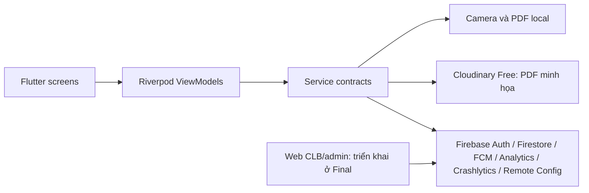

# Kiến trúc EventHub — Lab 3

Cập nhật 04/11/2026. Mobile là Flutter Android theo MVVM với Riverpod. CLB và admin dùng web riêng; app mobile không có quyền điều khiển web CLB.

## Luồng dữ liệu

Không dùng Cloud Functions hay Firebase Storage trong app. `functions/` là mã thử nghiệm cũ, không có trong `firebase.json` và không được deploy. `lib/main_prototype.dart` chỉ mô phỏng UI; bản chạy thật là `lib/main.dart`.

## Nghiệp vụ Firestore hiện tại

- Đăng ký và hủy chạy qua transaction Firestore. Mỗi tài khoản/sự kiện có một ID đăng ký xác định. Cùng transaction thay đổi đăng ký và `events.activeCount`; Security Rules dùng `getAfter()` để kiểm tra hai bản ghi cùng thay đổi và chặn ghi số chỗ riêng lẻ. Rules dùng `request.time` cho hạn đăng ký, thời điểm bắt đầu và `serverTimestamp()` cho thời gian lưu.
- Mỗi lệnh có `operationId` lưu trong đăng ký. Khi mất phản hồi, app giữ lệnh cục bộ theo UID, hỏi server trước khi gửi lại cùng ID. Không suy ra thành công hay thất bại từ timeout. Mỗi người chỉ có một đăng ký hoạt động cho cùng sự kiện; re-register sau hủy tăng `generation`.
- Điểm danh: web CLB phải tạo QR ngẫu nhiên đủ dài, lưu SHA-256 vào `qrCredentials/{hash}` và mở `checkinSessions/{eventId}`. Mobile chỉ quét token, ghi hash và thời gian; Security Rules kiểm tra QR, event, session và đăng ký. Mobile không đọc danh sách QR hoặc tự mở session.
- Event và đăng ký chỉ hiện cho tài khoản có email đã xác nhận. Chủ user đọc đăng ký của mình. Việc tạo/sửa sự kiện, phiên QR, thông báo của người khác cần web/admin đáng tin cậy; không cấp quyền này cho mobile.
- Firestore trực tiếp thay thế Functions theo quyết định mới, nên chưa có `history`/operation ledger riêng. Recovery dựa trên `lastOperationId` của đăng ký hiện tại; nếu tài khoản khác thay đổi cùng đăng ký trong lúc lệnh cũ chưa rõ, app giữ trạng thái chưa xác định để kiểm tra thủ công. Cần E2E đa thiết bị trước khi chốt sản phẩm.

## PDF và Cloudinary

PDF chứa tên sự kiện, CLB, thời gian, địa điểm và trạng thái; không chứa email/số điện thoại. File được tạo cục bộ rồi upload bằng unsigned preset Cloudinary Free với `resource_type=raw`. `CLOUDINARY_CLOUD_NAME` và `CLOUDINARY_UPLOAD_PRESET` là cấu hình công khai truyền qua `--dart-define`, không phải secret. **Ai có URL đều có thể xem PDF.** Preset unsigned có thể bị lạm dụng; Console phải hạn chế định dạng PDF, dung lượng tối đa 5 MB, thư mục riêng. Không dùng Cloudinary cho dữ liệu nhạy cảm hoặc làm nguồn sự thật của đăng ký. Xem [hướng dẫn cấu hình](cloudinary-setup.md).

## Phần phải kiểm tra trên cloud

Emulator đã xác minh Rules cho đăng ký, hủy, QR hợp lệ và giả mạo. Cần chạy trên Android với project thật và ghi bằng chứng: Auth, Firestore transaction, QR do web CLB tạo, PDF Cloudinary, FCM ba trạng thái, Analytics DebugView, Crashlytics, Remote Config trước/sau. ARTEMIS và AI review PR vẫn cần môi trường/tài khoản riêng. Bảng trạng thái hiện hành ở [lab3-readiness.md](lab3-readiness.md).
