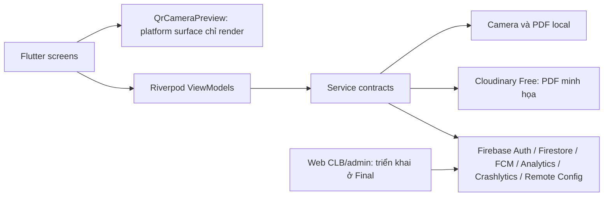
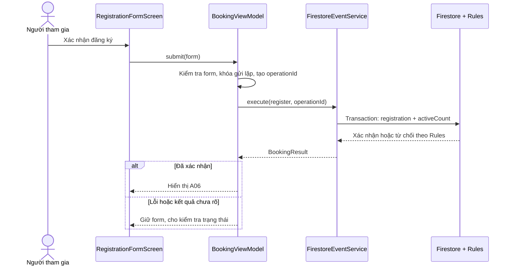

# Kiến trúc Final — cập nhật 13/11/2026

- mobile/lib: Views → Riverpod ViewModels → contracts/services của packages/core. Camera, file PDF và native share là adapter riêng Android.
- web/lib: Views → web ViewModels → cùng packagecore; FirebaseWebAuthService/FirestoreClubService/FirestoreAdminService implementation nằm trong packages/core/lib/services/firebase.
- packages/core/lib: model/status/validation, hợp đồng, services Firestore/Auth, theme, component, font/icon dùng chung. File export tương thích trong mobile và web giữ import cũ mà không sao chép implementation.
- Không custom server, Functions hoặc Storage. Mọi nghiệp vụ ghi Firestore được Security Rules kiểm tra. App Check attestation là cấu hình Console bổ sung, không thay thế Auth/Rules.
- Mobile chỉ mở UID-scoped providers khi role user được xác minh bằng stream Firestore. Role đổi hoặc logout làm reset private state; camera chỉ chạy cho đăng ký được duyệt.
- Inbox kết hợp thông báo riêng, announcements và receipts; lọc scope theo current registrations; stream errors hiển thị retry.
- PDF: ReportService → LocalReportFileService → vùng riêng của app; ReportMetadataService → users/{uid}/reports. Chia sẻ file do người dùng chọn qua Android, không upload Cloudinary. Logout dọn file local chưa chia sẻ; metadata vẫn là lịch sử riêng của chủ tài khoản.

Hồ sơ kiến trúc Lab 3 bên dưới chỉ mô tả nền cũ; khi mâu thuẫn, phần Final trên và mobile-setup.md là hiện hành.

---

# Kiến trúc EventHub — Lab 3

Cập nhật 07/11/2026. Mobile là Flutter Android theo MVVM với Riverpod. CLB và admin dùng web riêng; app mobile không có quyền điều khiển web CLB.

## Luồng dữ liệu

## Cấu trúc và ranh giới lớp

| Thư mục | Trách nhiệm |
|---|---|
| `lib/models/` | Kiểu dữ liệu và trạng thái, không gọi SDK. |
| `lib/screens/` | Hiển thị và nhận thao tác; không truy cập Firebase/HTTP trực tiếp. |
| `lib/viewmodels/` | Điều phối trạng thái, kiểm tra dữ liệu nhập và nghiệp vụ màn hình. |
| `lib/services/contracts/` | Giao diện service để thay bằng fake trong test. |
| `lib/services/firebase/` | Firebase Auth, Firestore và các SDK cloud. |
| `lib/services/cloudinary/`, `lib/services/report/` | Upload PDF và tạo PDF từ dữ liệu đang xem. |
| `lib/app/` | Composition root, router, bootstrap và vòng đời ứng dụng; không được import từ ViewModel. |
| `lib/services/*providers.dart`, `cloud_service_provider.dart` | Cung cấp service qua contract; không import ViewModel hoặc UI. |
| `lib/theme/`, `lib/widgets/` | Token giao diện và widget dùng lại. |
| `lib/utils/` | Hàm thuần, không phụ thuộc UI. |

`session_viewmodel.dart` sở hữu phiên và UID; `event_data_providers.dart` sở hữu các stream AsyncValue; `cloud_state.dart` điều phối cloud theo phiên. Các provider service nằm trong `services/`; test override contract tại đó. Cách tổ chức này loại bỏ vòng import `app → ViewModel → app` mà không đổi route hoặc nghiệp vụ.

View phụ thuộc ViewModel và widget. ScannerScreen chỉ chuyển tiếp lifecycle/user events tới ScannerViewModel. QrCameraPreview chỉ render MobileScanner bằng handle; không gọi start/stop/quyền/SDK network. QrCameraService không trả Widget, được inject qua QrCamera contract trong services/qr_camera_provider.dart. ViewModel phụ thuộc service contract/model; Firebase và HTTP chỉ xuất hiện ở service hoặc lớp khởi tạo provider. Không đưa SDK vào `build()`.

| ViewModel | Service được inject | Luồng chính |
|---|---|---|
| `AuthViewModel`, `SessionViewModel` | Auth service | Đăng nhập, xác nhận email, đăng xuất và điều hướng theo phiên. |
| `EventFilterViewModel`, event/detail providers | Event service | Khám phá, tìm/lọc và chi tiết sự kiện. |
| `BookingViewModel` | Event service, pending-operation store | Đăng ký, hủy, điểm danh và tra kết quả chưa rõ. |
| `NotificationsViewModel` | Notification service | Hộp thư trong app và trạng thái đã đọc. |
| `ProfileViewModel` | Profile/Auth service | Xem và sửa hồ sơ. |
| `ExportViewModel` | Report service, report storage service | Tạo PDF, upload và hiển thị liên kết. |
| `ScannerViewModel` | QrCamera contract, BookingViewModel và registration provider | Camera lifecycle, error state, khóa scan trùng; không scan khi pending hoặc đã điểm danh. |
| `CloudToolsViewModel` | Cloud services | FCM, Remote Config, Crashlytics thử nghiệm. |

Ví dụ trình tự F1 (chỉ hiện thành công khi Firestore xác nhận):

App dùng Firestore trực tiếp và Cloudinary; không có target prototype hoặc backend Functions.

## Nghiệp vụ Firestore hiện tại

- Đăng ký và hủy chạy qua transaction Firestore. Mỗi tài khoản/sự kiện có một ID đăng ký xác định. Cùng transaction thay đổi đăng ký và `events.activeCount`; Security Rules dùng `getAfter()` để kiểm tra hai bản ghi cùng thay đổi và chặn ghi số chỗ riêng lẻ. Rules dùng `request.time` cho hạn đăng ký, thời điểm bắt đầu và `serverTimestamp()` cho thời gian lưu.
- Mỗi lệnh có `operationId` lưu trong đăng ký. Khi mất phản hồi, app giữ lệnh cục bộ theo UID, hỏi server trước khi gửi lại cùng ID. Không suy ra thành công hay thất bại từ timeout. Mỗi người chỉ có một đăng ký hoạt động cho cùng sự kiện; re-register sau hủy tăng `generation`.
- Điểm danh: web CLB phải tạo QR ngẫu nhiên đủ dài, lưu SHA-256 vào `qrCredentials/{hash}` và mở `checkinSessions/{eventId}`. Mobile chỉ quét token, ghi hash và thời gian; Security Rules kiểm tra QR, event, session và đăng ký. Mobile không đọc danh sách QR hoặc tự mở session. Khi quét có thể get chính xác SHA-256 credential để phân biệt lỗi; chỉ chủ đăng ký active được get session cho sự kiện đó. Không nhận token gốc từ Firestore.
- Event và đăng ký chỉ hiện cho tài khoản có email đã xác nhận. Chủ user đọc đăng ký của mình. Việc tạo/sửa sự kiện, phiên QR, thông báo của người khác cần web/admin đáng tin cậy; không cấp quyền này cho mobile.
- Firestore trực tiếp thay thế Functions theo quyết định mới, nên chưa có `history`/operation ledger riêng. Recovery dựa trên `lastOperationId` của đăng ký hiện tại; nếu thiết bị khác của cùng tài khoản thay đổi đăng ký trong lúc lệnh cũ chưa rõ, app giữ trạng thái chưa xác định để kiểm tra thủ công. Cần E2E đa thiết bị trước khi chốt sản phẩm.

## PDF và Cloudinary

PDF chứa tên sự kiện, CLB, thời gian, địa điểm và trạng thái; không chứa email/số điện thoại. File được tạo cục bộ rồi upload bằng unsigned preset Cloudinary Free với `resource_type=raw`. `CLOUDINARY_CLOUD_NAME` và `CLOUDINARY_UPLOAD_PRESET` là cấu hình công khai truyền qua `--dart-define`, không phải secret. **Ai có URL đều có thể xem PDF.** Preset unsigned có thể bị lạm dụng; Console phải hạn chế định dạng PDF, dung lượng tối đa 5 MB, thư mục riêng. Không dùng Cloudinary cho dữ liệu nhạy cảm hoặc làm nguồn sự thật của đăng ký. Xem [hướng dẫn cấu hình](cloudinary-setup.md).

## Phần phải kiểm tra trên cloud

Emulator đã xác minh Rules cho đăng ký, hủy, QR hợp lệ và giả mạo. Cần chạy trên Android với project thật và ghi bằng chứng: Auth, Firestore transaction, QR/phiên fixture do người quản lý chuẩn bị qua Console cho Lab 3 (web CLB thuộc Final), PDF Cloudinary, FCM ba trạng thái, Analytics DebugView, Crashlytics, Remote Config trước/sau. Ảnh FCM ba trạng thái, Crashlytics lỗi thực/UID/key và Remote Config trước/sau đã lưu trong evidence/instrumentation; xem status.md tại đó để phân biệt phần có ảnh và phần còn thiếu. ARTEMIS hoãn theo yêu cầu người dùng; AI review hiện có PR #3, còn điểm lịch sử commit cần ghi trung thực. Bảng trạng thái hiện hành ở [lab3-readiness.md](lab3-readiness.md).

## Packages và tương thích sau merge

`packages/core/` chứa lớp dùng chung do teammate thêm; `web/` là package web riêng. Mobile vẫn dùng các model lib/models và một số widget/theme local; không tuyên bố toàn bộ đã migrate sang core. Root analyze kiểm mobile, từng package kiểm riêng. Rules giữ luồng Lab3 đăng ký trực tiếp cho event không có clubId và luồng web xét duyệt cho event có clubId; mobile không được tự bỏ clubId ở event. Không thêm workflow duyệt vào các event Lab3 đã chốt.

## Dữ liệu local và đăng xuất

Firebase bootstrap đã cấu hình persistenceEnabled=false trước khi truy vấn ở main isolate. Không bổ sung clearPersistence khi SDK đang hoạt động. Pending command nằm trong secure storage theo UID: logout bị chặn khi booking busy, sau đó clear pending của UID hiện tại trước signOut. Lần đăng nhập sau đọc lại server; không tự replay lệnh đã xóa. Nếu clear thất bại, hiển thị lỗi và không giả báo logout thành công. Các VM/profile/report/notification dựa UID bỏ state cũ khi phiên đổi. Kiểm thử hai tài khoản và offline/native vẫn cần ảnh xác nhận.

Design-system mapping hiện hành: [flutter-handoff.md](flutter-handoff.md). Mobile_role_rejection còn dùng package core của teammate; không tự migrate/xóa web hoặc shared package trong sửa Lab3 này.
