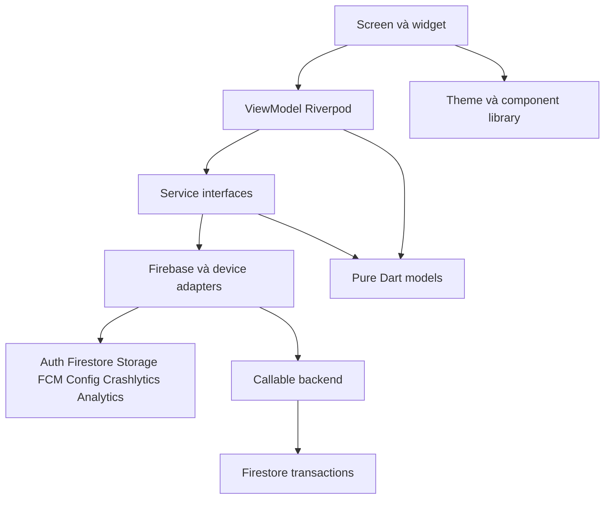
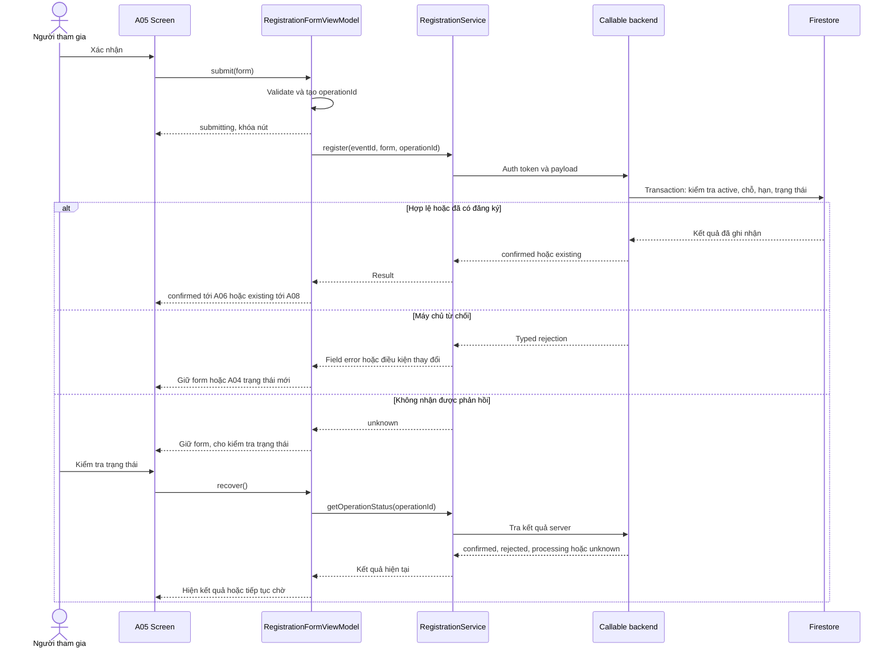

# Kiến trúc EventHub — Lab 3

Ngày: 30/10/2026. **Đặc tả trước khi code**, chưa có package pin, project Firebase hay kết quả test. Áp dụng [bảng đối chiếu](design-traceability.md); scope là mobile người tham gia, CLB/admin ở web riêng.

## 1. Lựa chọn và ranh giới

Chọn **Flutter Android + MVVM + Riverpod** để inject service và quản lý state độc lập widget. Chọn Firestore làm nguồn dữ liệu sản phẩm; Firebase Auth hỗ trợ Google và email/password. go_router dự kiến quản lý route/guard. Phiên bản cụ thể được kiểm tra và pin tại bước 3, không tự ghi phiên bản chưa cài.

SDK ngoài chỉ được gọi trong lớp service/adapter. View nhận state và gửi intent tới ViewModel; ViewModel gọi interface service và trả state bất biến. Model không import Flutter/SDK. Theme/widgets dùng lại nằm riêng, không chứa quy tắc đăng ký. Composition root tạo implementation và inject qua Riverpod.

Đăng ký/hủy/check-in cần kiểm tra nguyên tử theo thời gian máy chủ. **Lựa chọn backend dự kiến: Firebase callable Cloud Functions + Firestore transaction.** Đây là dịch vụ bổ sung để thực thi nghiệp vụ, không thay một trong sáu dịch vụ đề yêu cầu. Khả năng triển khai/gói thanh toán Functions và Storage phải xác minh trước bước 4; nếu không khả dụng, xin thầy phương án backend tương đương. Không âm thầm chuyển kiểm tra quyền/sức chứa sang client để tránh cấu hình backend.

Mũi tên biểu diễn hướng gọi; interface không import adapter cụ thể. Adapter implements interface; chỉ `app/providers.dart` biết implementation. Không widget nào gọi `FirebaseAuth.instance`, `http`, SDK camera hay analytics trực tiếp.

## 2. Thư mục dự kiến

| Đường dẫn | Vai trò |
|---|---|
| `lib/main.dart` | Khởi động app, tạo dependency scope, không logic nghiệp vụ |
| `lib/app/` | App root, composition root, route và auth guard |
| `lib/models/` | Entity/value object, query/filter, DTO thuần Dart |
| `lib/services/contracts/` | Interface mà ViewModel phụ thuộc |
| `lib/services/firebase/` | Adapter Auth/Firestore/Functions/Storage/FCM/Analytics/Crashlytics/Config |
| `lib/services/device/` | Camera, permission, lifecycle, temporary files |
| `lib/services/report/` | Sinh PDF từ snapshot dữ liệu thật |
| `lib/viewmodels/` | State, intent và điều phối nghiệp vụ từng màn |
| `lib/screens/` | Layout các route A01–A12 và màn bổ sung |
| `lib/widgets/` | Component dùng lại theo Lab 2, nhận state qua tham số |
| `lib/theme/` | ColorScheme/TextTheme, semantic extensions, spacing/radius/elevation |
| `lib/utils/` | Formatter ngày giờ, validator thuần, typed Result/AppFailure |
| `functions/` | Backend transaction, kiểm tra quyền, notification outbox; có khi chọn phương án Functions |
| `firebase/` | Firestore/storage rules, indexes, Remote Config defaults |
| `test/` | Test VM/service nghiệp vụ quan trọng với fake injected services |
| `e2e_test/` | ARTEMIS pytest, conftest, pyproject và các case độc lập |
| `docs/` | Traceability, kiến trúc, analytics/test/review plans |
| `evidence/` | Ảnh console/app, trace và bảng kết quả có nguồn |
| `report/`, `slides/` | PDF nộp theo đề |

Đây là sơ đồ thư mục tương lai; chưa tạo hàng loạt file code rỗng.

## 3. ViewModel và dependency

| ViewModel | Màn | Service sử dụng |
|---|---|---|
| SessionViewModel | Root guard | AuthService, NotificationService, AnalyticsService, DiagnosticsService |
| AuthViewModel | A01a–d | AuthService, ProfileService, AnalyticsService |
| DiscoverViewModel | A02 | EventService, ConfigService, AnalyticsService |
| SearchViewModel | A03 | EventService, AnalyticsService |
| EventDetailViewModel | A04 | EventService, RegistrationService, AnalyticsService |
| RegistrationFormViewModel | A05 | ProfileService, RegistrationService, AnalyticsService, DiagnosticsService |
| RegistrationDetailViewModel | A06/A08 | RegistrationService, EventService, CheckInService, AnalyticsService, DiagnosticsService |
| ScheduleViewModel | A07 | RegistrationService, EventService, AnalyticsService |
| NotificationsViewModel | A09 | NotificationService, AnalyticsService |
| AccountViewModel | A10/edit | ProfileService, AuthService, AnalyticsService |
| ScannerViewModel | A11 | CameraService, CheckInService, AnalyticsService, DiagnosticsService |
| CheckInResultViewModel | A12 | CheckInService, EventService, AnalyticsService |
| ExportViewModel | L3-02 | RegistrationService, EventService, ReportService, StorageService, AnalyticsService, DiagnosticsService |
| FirebaseDemoViewModel | L3-01 | ConfigService, DiagnosticsService, NotificationService |

Service interface trả model/Result, không trả Firestore DocumentSnapshot hoặc FirebaseException ra ViewModel. Adapter đổi lỗi SDK sang `AppFailure` có code, retryability và thông báo an toàn. Analytics/diagnostics lỗi không làm thất bại nghiệp vụ chính.

## 4. Model dữ liệu và quyền

| Collection/path dự kiến | Trường chính | Ai được đọc/ghi |
|---|---|---|
| `users/{uid}` | displayName, contactEmail, pendingContactEmail, contactEmailVerified, updatedAt | Chủ user đọc; update trường cho phép qua ProfileService/backend; client không tự set verified/role |
| `clubs/{clubId}` | name, description, publicContact | User đã auth đọc thông tin công khai; organizer/admin backend ghi |
| `events/{eventId}` | clubId, title, description, activities, audience, preparation, speakers, location, startsAt, endsAt, registrationMode, deadline, capacity, activeCount, status, revision | App đọc published/cancelled phù hợp; chỉ backend có quyền organizer ghi; free bỏ capacity/deadline |
| `registrations/{id}` | uid, eventId, generation, status(active/cancelled), participantSnapshot, createdAt, cancelledAt, checkInAt | Chủ user đọc; backend ghi. `id` tạo từ uid/eventId theo mã hóa an toàn hoặc hash xác định |
| `registrations/{id}/history/{entryId}` | generation, operationId, action, timestamp, snapshot | Chủ user đọc; backend append, giữ lịch sử khi hủy/đăng ký lại |
| `checkinSessions/{eventId}` | open, openedAt, closedAt, updatedBy | Người có đăng ký đọc trạng thái; organizer backend ghi |
| `qrCredentials/{tokenHash}` | eventId, enabled | Backend đọc/ghi; app không đọc collection; QR web chứa opaque token không chứa danh tính |
| `operations/{uid_opId}` | uid, type, eventId, requestHash, status, result, generation, createdAt | Chủ user đọc qua backend; chỉ backend ghi; chống tái gửi |
| `users/{uid}/notifications/{id}` | type, eventId, registrationId, title, body, createdAt, readAt | Chủ user đọc/đánh dấu readAt; backend tạo nội dung |
| `users/{uid}/devices/{deviceId}` | fcmToken, platform, updatedAt | Chủ user đăng ký/gỡ qua service, backend gửi; không công khai token |
| `notificationOutbox/{id}` | eventRevision, recipients, processingState | Backend-only; retry idempotent |
| Storage `reports/{uid}/{fileId}.pdf` | PDF, contentType, size | Chủ user theo rules; validate MIME/giới hạn kích thước |

Mọi thời điểm lưu UTC Timestamp, hiển thị Asia/Ho_Chi_Minh. Đổi lịch tăng revision; thông báo mở dữ liệu mới nhất. participantSnapshot giữ dữ liệu lúc đăng ký; sửa profile không tự sửa lịch sử. A12 chỉ lấy tên/nhóm/K, không đưa email/điện thoại lên UI hoặc analytics.

Tài khoản auth không có quyền organizer chỉ vì tự khai FPTU/K. Quyền CLB/admin được cấp qua backend đáng tin cậy, không sửa được từ mobile. Rules default-deny; Firestore query phải giới hạn `uid == currentUid` khi đọc đăng ký. Auth email/password chưa xác minh không vào nội dung; backend cũng kiểm tra điều kiện auth tương ứng.

**Nguồn dữ liệu thật:** cần sự kiện do CLB nhập trên web riêng hoặc dữ liệu sự kiện được phép sử dụng nhập qua công cụ backend tin cậy. Dữ liệu test được gắn môi trường test và reset có kiểm soát; không nhúng workshop mẫu vào code bản nộp. Chưa có bằng chứng web/backend CLB đang vận hành; đây là phụ thuộc cần kết nối tại bước 4–7. Không mở rộng sang xây cả admin portal trong bước 1–2.

## 5. API nghiệp vụ và chống gửi trùng

Các contract dự kiến:

- `registerEvent(eventId, participant, operationId)` xác thực user; nếu đăng ký active đã có, trả existing trước khi xét chỗ/hạn; ngược lại kiểm tra mode, status, deadline, capacity, validate trường theo nhóm. Transaction cập nhật activeCount và đăng ký/history/operation cùng nhau. Tái đăng ký sau hủy tăng generation, giữ history, không hồi sinh operation cũ.
- `cancelRegistration(id, generation, operationId)` kiểm tra chủ sở hữu, active, chưa check-in, sự kiện chưa bắt đầu và chưa hủy; transaction đổi trạng thái, giảm activeCount đúng một lần và ghi history/operation. Hiển thị số chỗ chỉ khi sự kiện còn nhận đăng ký.
- `checkIn(id, generation, qrToken, operationId)` kiểm tra QR đúng event, active registration, event không hủy, session mở. Đã check-in trả giờ gốc; nếu chưa thì ghi server timestamp một lần. Không dùng GPS hay QR làm bằng chứng danh tính.
- `getOperationStatus(operationId)` và đọc đăng ký server xác định kết quả; không suy ra thất bại từ timeout hoặc cache. Backend trả typed result: confirmed/existing/rejected/processing/unknown. `not_found` của operation chưa đủ để khẳng định request cũ không còn chạy; trước lần gửi lại dùng cùng operationId/payload để đảm bảo idempotency, hoặc backend xác nhận attempt cũ kết thúc rồi mới tạo ID mới.

`operationId` tạo trước gửi, giữ qua retry; requestHash ràng buộc nội dung; cùng ID khác payload bị từ chối. Backend kiểm tra generation khi hủy/check-in để request cũ không tác động đăng ký mới. Lưu metadata operation chờ theo UID nếu app bị đóng; không lưu mật khẩu. Đăng xuất xóa dữ liệu cục bộ của user.

## 6. State, điều hướng và lifecycle

Màn tải dữ liệu dùng `LoadState<T> = initial/loading/empty/data/error`; `data` có isStale/updatedAt. Lỗi refresh có thể giữ data cũ với banner, không xóa nội dung thành trắng. Command dùng `ActionState = idle/submitting/confirmed/rejected/unknown/checking`. Màn camera thêm permissionDenied/permanentlyDenied/scanning/paused. Không ép mọi màn có empty khi nghiệp vụ không áp dụng.

Auth state gồm restoring/signedOut/unverified/signedIn. AuthGate giữ pending destination hợp lệ, không chạy mutation tự động sau login. Bốn tab giữ stack/filter/scroll; route chi tiết kiểm tra quyền. Sign-out dừng listener/camera, invalidate provider user-scoped và gỡ device token; nếu mạng lỗi khi gỡ token, không hiển thị nội dung nhạy cảm trong push và lọc lại theo UID khi mở. Không để cache người trước xuất hiện ở người sau.

Camera tạm dừng khi app background, có overlay hoặc đang gửi check-in; hủy subscription khi rời A11. Các màn detail/form cuộn, CTA nằm trong SafeArea và không che nội dung/bàn phím. Read cache có nhãn chưa cập nhật; write nghiệp vụ yêu cầu server, không xếp hàng offline tự báo thành công.

Firestore không cung cấp full-text tùy ý như công cụ search chuyên dụng. MVP: query tập published theo campus/ngày/chủ đề/CLB, tải đủ tập ứng viên trong phạm vi thời gian được UI ghi rõ rồi chuẩn hóa tiếng Việt/lọc từ khóa trong EventService. Không báo tổng chính xác khi chưa tải đủ trang; quy mô vượt giới hạn phải chuyển search backend và ghi deviation. Remote Config không được âm thầm cắt tập tìm kiếm.

## 7. Theme và widget

| Figma | Flutter dự kiến |
|---|---|
| Action/Primary `#C74316`, OnAction `#FFFFFF` | ColorScheme.primary/onPrimary |
| Text/Primary `#2B3445`, Surface/Default `#FFFFFF` | onSurface/surface |
| Error `#B4233F`, ErrorSurface `#FDE4E8` | error/errorContainer |
| Secondary text `#5F6B7A`, border `#E3E7ED/#CBD2DC`, subtle `#F8F9FB` | ColorScheme và EventHubSemanticColors extension |
| Success `#147A55/#DDF4E8`, warning `#9A5B00/#FFF0D5`, info `#315F9A/#E7F0FC` | Semantic extensions, không dùng màu độc lập để truyền nghĩa |
| Be Vietnam Pro; 32/40, 28/36, 24/32, 20/28, 18/26 | displaySmall, headlineMedium/Small, titleLarge/Medium |
| Body 16/24, 14/21; label 16/24,14/20; phụ 12/18,12/16 | TextTheme; 12 chỉ nhãn phụ, body ≥14 |
| Spacing 0/4/8/12/16/20/24/32/40/48 | AppSpacing constants; lề mặc định 16, section gap 24 |
| Radius 6/8/12/16/24/999 | AppRadius constants |
| Elevation 0; 0/2/8/0 6%; 0/8/24/0 10% | AppShadows, giữ thông số BoxShadow phù hợp |
| Icon 16/20/24, stroke 2; touch ≥48 | AppIconTokens, AppTouchTargets |

Ánh xạ toàn bộ component ở [traceability mục 4](design-traceability.md#4-component--widget). Màn không hard-code màu/font/padding; dùng theme/constants. Không thay cover/ảnh sự kiện thành dữ liệu giả. Thêm Semantics nhãn và value cho search, card, tab, nút, progress; body hỗ trợ text scale và kiểm tra 360/412 dp. Token trên lấy từ tài liệu Lab 2 đã đọc; cần đối chiếu style thực khi dựng UI, không coi đây là phép đo accessibility đã pass.

## 8. Sáu dịch vụ Firebase và dữ liệu bổ sung

| Dịch vụ | Adapter / hành vi | Lỗi và bằng chứng cần có |
|---|---|---|
| Authentication | AuthService, Google + password; verified email không chứng minh sinh viên | cancel/network/reauth; ảnh app và Users |
| Storage | StorageService, reports/uid; ReportService tạo PDF lịch từ snapshot hiện tại | progress, denied/network/retry; URL và console file list |
| Messaging | NotificationService: token, permission, foreground/background/initial message | từ chối quyền vẫn đọc inbox; ba trạng thái nhận và tap route |
| Analytics | AnalyticsService, typed event API; user ID sau login, clear sau logout | plan ≥7 trước tracking, mỗi event có DebugView, không PII |
| Crashlytics | DiagnosticsService, lỗi thật đã xử lý + test crash; UID/custom key | redact QR token/contact; dashboard cả fatal/nonfatal |
| Remote Config | ConfigService, defaults + fetch/activate | fallback offline; ≥2 thay đổi hành vi và ảnh trước/sau |

Config dự kiến: `discover_featured_limit=6` (giới hạn khối gợi ý, không cắt search), `discover_recommendations_enabled=true` (ẩn/hiện khối). Validate range/type; refresh áp dụng mà không rebuild. Không dùng config cho auth/authorization.

Thông báo: backend tạo inbox trước khi gửi FCM; inbox là nguồn chính nên từ chối quyền push vẫn thấy A09. Dùng ID ổn định chống trùng và outbox retry; client không được gửi FCM cho người khác. Khi terminated, tap được giữ pending tới lúc auth/router sẵn sàng. Không cho rằng FCM luôn giao thành công hoặc giao khi force-stop; test đúng trạng thái lifecycle yêu cầu.

Export: PDF chụp snapshot lịch đang xem, tên sự kiện/giờ/địa điểm/trạng thái và thời điểm xuất; không chứa contact người khác. URL tải có thể là bearer link: cảnh báo chia sẻ riêng tư trong UI, không ghi URL vào analytics/log. Rules kiểm tra user nhưng không coi URL token là truy cập riêng chỉ nhờ rules. Có thể dùng link ngắn hạn qua backend nếu cần; ghi lựa chọn lúc triển khai.

A10 phân biệt login email và contact email. Google login email không sửa tùy ý; thay contact cần verify server, email cũ còn hiệu lực tới xác minh. Password provider thay email theo quy trình Auth có reauthentication; khi email provider trùng không tự gộp tài khoản mà yêu cầu đăng nhập provider gốc và liên kết có xác thực.

## 9. Kiểm tra kiến trúc trước khi triển khai và rủi ro còn mở

- Tài liệu đáp ứng cấu trúc thư mục, sơ đồ lớp, sequence và bảng VM/service của đề; chưa có code để xác minh MVVM.
- Test ưu tiên: form student/guest; register cuối chỗ có cạnh tranh; duplicate/retry; hủy vs check-in đồng thời; generation; sign-out không rò state; recovery server. Fake services chỉ trong test; build nộp dùng backend thật.
- Bước 3 pin dependencies và kiểm tra thiết bị/ARTEMIS; bước 4 xác minh tài khoản/gói Firebase và backend. Không hứa Spark đủ cho mọi dịch vụ khi chưa kiểm tra khả năng cung cấp thực tế.
- Cần nguồn sự kiện thật, quyền organizer và web hiển thị QR/mở phiên; chưa có endpoint hoặc project ID nên chưa ghi như đã kết nối.
- Các thay đổi UI Lab 3 D01/D02/D03/D07 chưa áp dụng Figma. Ghi nhận việc này trước khi code UI mới; không coi Lab 2 bị mở lại vì các yêu cầu mới của Lab 3.

**Bước 2 đã hoàn thành ở mức thiết kế kiến trúc.** Việc tạo project, cấu hình dịch vụ, kiểm tra rules và chạy test thuộc các bước tiếp theo.
