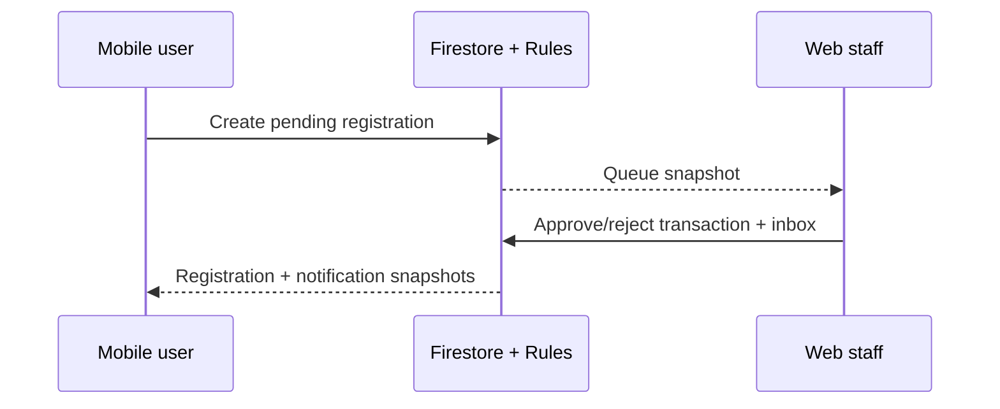

# Cross-role flow — Final (Appendix C)

Code hiện có; **chưa có bằng chứng 3 lượt end-to-end trên deployment hoặc số đo realtime**. Không dùng mock/HTTP bridge hay ảnh fixture thay bằng chứng. Một project Firestore, shared package core, Security Rules + App Check; không custom server/Functions.

## Luồng chính: user đăng ký → web duyệt → mobile cập nhật/inbox

Tiền điều kiện: mobile user, web staff đúng clubId, sự kiện published/public còn hạn/chỗ. Web URL phải được triển khai và mở được trong cửa sổ ẩn danh. Admin có quyền theo isStaffOf trong Rules; không tuyên bố Rules cấm admin can thiệp tuyệt đối.

| Bước | Actor/client và màn | Firestore write | Rule cho phép | Client còn lại |
|---|---|---|---|---|
| 1 | User/mobile A05 | registrations/{uid}_{eventId}: uid/eventId/clubId, status=pending, participant, generation, createdAt, lastOperationId | isUser, chủ UID, event đúng điều kiện, shape hợp lệ; không tự approved | Web review queue thấy pending |
| 2A | Staff/web Review Queue approve | Registration pending→approved, reviewedBy/reviewedAt; event.activeCount +1; users/{uid}/notifications tin kết quả | Staff đúng CLB (hoặc admin), getAfter bảo vệ count/capacity; notifications đúng event | Mobile A07/A08 hiển thị approved, A09 tin mới |
| 2B | Staff/web Review Queue reject | Registration pending→rejected, reason, reviewedBy/reviewedAt; tin kết quả | Đúng role/club, reason hợp lệ, count không đổi | Mobile hiển thị rejected + lý do, inbox |
| 3 | Staff/web Announcement form | announcements: title/body/scope/clubId/eventId/authorUid/authorRole/createdAt | Staff đúng scope CLB/event, admin cho global; shape/time đúng | Mobile A09 đọc tin đúng scope, read receipt theo UID |

Inbox dùng Firestore snapshots, không đồng nghĩa gửi push FCM tự động. FCM là phần instrumentation kế thừa, test riêng qua Console.

## Luồng QR đang có (không bắt buộc thêm flow bonus)

| Bước | Actor/client | Write và Rules | UI phía còn lại |
|---|---|---|---|
| Mở phiên | Staff/web live QR | checkinSessions/{eventId} open; qrCredentials/{sha256(rawToken)} enabled, scope đúng event/club | Mobile approved đọc phiên và được mở scanner |
| Điểm danh | User/mobile A11 | approved/chưa check-in; QR đúng event/phiên mở; cập nhật checkInAt=request.time, qrHash, lastOperationId | A12 giữ mốc gốc; web participant/check-in count cập nhật |
| Đóng/xoay QR | Staff/web | Chỉ staff đúng event/club hoặc admin được sửa session/credential | Lần quét mới bị chặn khi phiên đóng/mã cũ disabled |

Mobile không mở web quản trị hoặc tạo QR. Check-in không đổi status thành ATTENDED; approved + checkInAt là nguồn hiển thị.

## Kiểm thử và đo thời gian — chưa thực hiện đủ

Thực hiện 3 lượt độc lập trên web deployment và Android dùng cùng Firebase. Quay hai client đồng thời, ghi thời gian write và khi UI phía nhận cập nhật. Đo bằng timestamp/video thực tế; ghi phương pháp và sai số, không suy thời gian từ unit test.

| Chiều cập nhật | Run 1 | Run 2 | Run 3 | Trung bình | Evidence |
|---|---|---|---|---|---|
| Mobile pending → web queue | Chưa đo | Chưa đo | Chưa đo | Chưa có | Chưa có |
| Web approve/reject → mobile state/inbox | Chưa đo | Chưa đo | Chưa đo | Chưa có | Chưa có |
| Announcement → mobile inbox | Chưa đo | Chưa đo | Chưa đo | Chưa có | Chưa có |

Test QR, lỗi mạng, role rejection và cạnh tranh sức chứa theo docs/test-plan.md; trạng thái đúng theo docs/test-report.md. Thiếu prerequisite ghi skipped/chưa chạy, không tạo kết quả giả.
