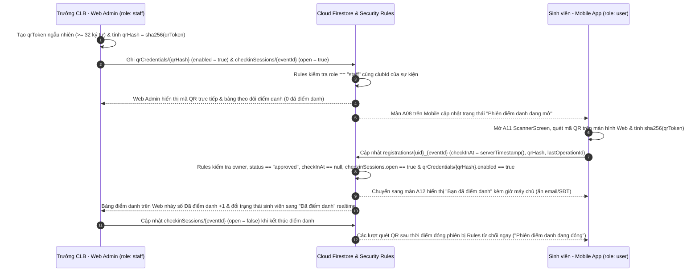

> Cập nhật đường dẫn Final: mobile/lib và packages/core/lib/services/firebase. Code và test local không thay cho bảng đo 3 lần trên hệ thống đã deploy. Rule isStaffOf hiện cho admin hoặc staff đúng CLB; UI web vẫn giữ ranh giới admin/CLB hiện có. Các mô tả “admin tuyệt đối không có quyền trong Rules” bên dưới không được dùng làm khẳng định bảo mật; xem firestore.rules hiện hành.

# Đặc tả Luồng Liên Vai Trò & Liên Thiết Bị (`Cross-Role Flows`)

Tài liệu này mô tả chi tiết các luồng nghiệp vụ liên vai trò và liên thiết bị (`cross-role flows`) của hệ thống **EventHub**:

0. **Luồng Khởi tạo — Đề xuất & Phê duyệt Sự kiện**: Trưởng CLB (`staff` trên **Web Admin**) tạo đơn đề xuất sự kiện (`pending_approval`) → Quản trị viên (`admin` trên **Web Admin**) phê duyệt (`Approve` → `published`) để chính thức lên lịch và công bố sự kiện cho sinh viên đăng ký.
1. **Luồng 1 — Đăng ký & Xét duyệt Tham gia Sự kiện Thời gian thực**: Sinh viên (`user` trên **Mobile App**) gửi đơn đăng ký `pending` → Trưởng CLB (`staff` trên **Web Admin**) độc quyền phê duyệt hoặc từ chối kèm lý do trên **Review Queue** (Quản trị viên không can thiệp vào việc duyệt người tham gia của CLB) → **Mobile App** cập nhật trạng thái đơn và nhận tin nhắn **Inbox** theo thời gian thực.
2. **Luồng 2 — Mở Phiên Phát Mã QR & Điểm danh Trực tiếp Thời gian thực**: Trưởng CLB (`staff` trên **Web Admin**) mở phiên điểm danh và phát mã QR động → Sinh viên đã được duyệt (`user` trên **Mobile App**) quét mã QR tại sự kiện → Cả biên nhận trên **Mobile App** lẫn bảng theo dõi trực tiếp trên **Web Admin** đồng bộ kết quả ngay tức thì.
---

## 1. Nguyên tắc Đồng bộ Không Máy chủ Riêng (Serverless Realtime Sync)

- **Một nguồn dữ liệu duy nhất**: Cả **Flutter Mobile App** và **Flutter Web Admin** cùng lắng nghe trực tiếp các luồng dữ liệu `.snapshots()` trên một dự án **Cloud Firestore** dùng chung và chia sẻ bộ model/service tại `packages/core/`.
- **Bảo vệ hoàn toàn bằng Security Rules**: Không sử dụng Cloud Functions hay backend trung gian. Mọi bước chuyển trạng thái (`pending → approved / rejected`, tăng/giảm nguyên tử `events/{eventId}.activeCount` bằng `getAfter()`, đối chiếu băm `sha256` khi quét QR) đều được kiểm chứng trực tiếp bởi `firebase/firestore.rules` dựa trên vai trò tại `users/{uid}.role` và phạm vi CLB tại `users/{uid}.clubId`.

---

## 2. Luồng 1 (Chính): Đăng ký Sự kiện (Mobile) → Xét duyệt trên Review Queue (Web) → Cập nhật Trạng thái & Inbox Realtime (Mobile)

### 2.1. Điều kiện Tiên quyết
- Tài khoản Sinh viên đã đăng nhập & xác minh email trên **Mobile App**, có `users/{studentUid}.role == 'user'`.
- Tài khoản Trưởng CLB đã đăng nhập bằng Google trên **Web Admin**, có `users/{staffUid}.role == 'staff'` và `users/{staffUid}.clubId == event.clubId`. *(Lưu ý: Quản trị viên hệ thống `admin` không tham gia phê duyệt đơn đăng ký của sinh viên, việc này thuộc thẩm quyền độc quyền của Trưởng CLB sở hữu sự kiện).*
- Sự kiện `events/{eventId}` đã được Admin phê duyệt (`status == 'published'`), `visibility == 'public'`, `registrationMode == 'required'`, chưa quá hạn `deadline` / `startsAt`, và `activeCount < capacity`.

### 2.2. Sơ đồ Tuần tự (Sequence Diagram)

```mermaid
sequenceDiagram
    autonumber
    participant M as Sinh viên - Mobile App (role: user)
    participant FS as Cloud Firestore & Security Rules
    participant W as Trưởng CLB - Web Admin (role: staff)

    Note over M,W: Hai client cùng mở kết nối lắng nghe realtime (.snapshots)
    M->>FS: Tạo/Gửi lại đơn tại registrations/{uid}_{eventId} (status = "pending")
    FS->>FS: Rules kiểm tra role == "user", form hợp lệ, sự kiện còn hạn & còn chỗ
    FS-->>M: Xác nhận ghi thành công -> Màn A06/A08 hiển thị "Chờ CLB duyệt"
    FS-->>W: Stream đẩy đơn mới vào màn Review Queue & tăng bộ đếm Pending trên Dashboard

    alt Nhánh 2A: Trưởng CLB Phê duyệt (Approve)
        W->>FS: Transaction: (1) registrations.status = "approved" + (2) events.activeCount + 1 + (3) Tạo users/{uid}/notifications/{notifId}
        FS->>FS: Rules kiểm tra staff cùng clubId, pending -> approved, getAfter(event).activeCount == old + 1 <= capacity
        FS-->>W: Đơn rời khỏi tab Chờ duyệt; số lượng Đã duyệt trên Web tăng ngay lập tức
        FS-->>M: Màn A07/A08 tự đổi sang "Đã duyệt" (mở nút Quét QR) & Tab Inbox A09 nổi thông báo mới
    else Nhánh 2B: Trưởng CLB Từ chối kèm lý do (Reject)
        W->>FS: Batch/Transaction: (1) registrations.status = "rejected", reason != "" + (2) Tạo users/{uid}/notifications/{notifId}
        FS->>FS: Rules kiểm tra staff cùng clubId, pending -> rejected, reason.size() > 0 (activeCount giữ nguyên)
        FS-->>W: Đơn chuyển sang lịch sử Đã từ chối kèm lý do lưu vết
        FS-->>M: Màn A07/A08 tự đổi sang "Bị từ chối" + hiển thị lý do; Tab Inbox A09 nổi thông báo kèm lý do
    end
```

### 2.3. Đặc tả Từng Bước theo Mẫu Appendix C

| Bước | Actor & Client | Màn hình (`Screen / Route`) | Thao tác Ghi Firestore (`Collection`, `Fields`) | Security Rule cho phép thao tác | Client bên kia hiển thị gì (`Realtime Update`) |
|---|---|---|---|---|---|
| **1. Gửi đăng ký** | **Sinh viên** (`role: user`) trên **Mobile App** | `A05 RegistrationFormScreen` (`/events/:eventId/register`) → `A06` (`/registrations/:id/success`) | **Ghi `registrations/{uid}_{eventId}`**:<br>`uid`: `request.auth.uid`<br>`eventId`: mã sự kiện<br>`clubId`: mã CLB của sự kiện<br>`status`: `'pending'`<br>`generation`: `1` *(hoặc `old + 1` nếu gửi lại sau hủy/từ chối)*<br>`participant`: `{name, email, group, cohort, organization, phone}`<br>`reason`: `null`, `checkInAt`: `null`<br>`createdAt`: `serverTimestamp()`<br>`lastOperationId`: chuỗi hex 48 ký tự | Người gọi đã xác thực, `users/{auth.uid}.role == 'user'`, ID tài liệu khớp `uid + '_' + eventId`, `status == 'pending'`, `participantValid()`, sự kiện đang `published`, chưa tới `deadline`/`startsAt` và `activeCount < capacity` (`activeCount` chưa tăng ở bước `pending`). | **Trên Web Admin (`staff` / `admin`)**:<br>- Màn **Review Queue (`/reviews`)** tự động xuất hiện thêm dòng đơn đăng ký mới ở đầu danh sách `Chờ duyệt` mà không cần tải lại trang.<br>- Chỉ số *Đơn chờ duyệt* trên **Dashboard (`/dashboard`)** nhảy tăng `+1`. |
| **2A. Phê duyệt đơn (`Approve`)** | **Trưởng CLB** (`role: staff` cùng `clubId`) trên **Web Admin** *(Admin không can thiệp)* | **Review Queue** (`/reviews`) | **Transaction nguyên tử gồm 3 thao tác ghi**:<br>1. **Cập nhật `registrations/{uid}_{eventId}`**: `status: 'approved'`, `reason: optionalNote`, `reviewedBy: staffUid`, `reviewedAt: serverTimestamp()`<br>2. **Cập nhật `events/{eventId}`**: `activeCount: resource.data.activeCount + 1`<br>3. **Tạo `users/{uid}/notifications/{notifId}`**: `{title, body, type: 'registration_approved', eventId, registrationId, createdAt: serverTimestamp(), readAt: null}` | Người gọi có `role == 'staff'` và `users/{auth.uid}.clubId == resource.data.clubId`; đơn gốc đang `status == 'pending'`; chỉ sửa các trường xét duyệt; đồng thời `getAfter(events/{eventId}).data.activeCount == get(events/{eventId}).data.activeCount + 1` và `<= capacity`. | **Trên Mobile App (`user`)**:<br>- Màn **Chi tiết đăng ký (`A08`)** và **Lịch tham gia (`A07`)** tự động đổi huy hiệu từ `Chờ duyệt` sang `Đã duyệt`, mở khóa nút **Quét QR**.<br>- Màn **Chi tiết sự kiện (`A04`)** giảm 1 chỗ trống còn lại.<br>- Tab **Thông báo / Inbox (`A09`)** xuất hiện ngay thông báo *"Đăng ký đã được CLB phê duyệt"* (chạm vào mở thẳng `A08`). |
| **2B. Từ chối đơn (`Reject`)** | **Trưởng CLB** (`role: staff` cùng `clubId`) trên **Web Admin** *(Admin không can thiệp)* | **Review Queue** (`/reviews` — hộp thoại nhập lý do) | **Batch / Transaction gồm 2 thao tác ghi**:<br>1. **Cập nhật `registrations/{uid}_{eventId}`**: `status: 'rejected'`, `reason: '<lý do bắt buộc>'`, `reviewedBy: staffUid`, `reviewedAt: serverTimestamp()`<br>2. **Tạo `users/{uid}/notifications/{notifId}`**: `{title, body: reason, type: 'registration_rejected', eventId, registrationId, createdAt: serverTimestamp(), readAt: null}` | Người gọi là `staff` đúng `clubId`; chuyển trạng thái hợp lệ duy nhất `pending → rejected`; bắt buộc `request.resource.data.reason is string` và `reason.size() >= 3 && reason.size() <= 300`; không được thay đổi `events/{eventId}.activeCount`. | **Trên Mobile App (`user`)**:<br>- Màn **`A08`** và **`A07`** chuyển ngay sang trạng thái `Bị từ chối`, hiển thị khung nêu rõ **lý do từ chối** của Trưởng CLB và mở lại tùy chọn gửi đăng ký lại nếu sự kiện còn hạn.<br>- Tab **Inbox (`A09`)** xuất hiện ngay thông báo từ chối kèm lý do chi tiết. |

---

## 3. Luồng 2 (Mở rộng — Bonus): Trưởng CLB Mở Phiên Phát Mã QR (Web) → Sinh viên Quét QR Điểm danh (Mobile) → Đồng bộ Realtime Cả Hai Client

### 3.1. Điều kiện Tiên quyết
- Đơn đăng ký `registrations/{uid}_{eventId}` của Sinh viên đã được phê duyệt ở Luồng 1 (`status == 'approved'`) và chưa điểm danh (`checkInAt == null`).
- Sự kiện `events/{eventId}` đang ở trạng thái `status == 'published'`.
- Thiết bị Android của Sinh viên đã cấp quyền sử dụng Camera.

### 3.2. Sơ đồ Tuần tự (Sequence Diagram)



### 3.3. Đặc tả Từng Bước theo Mẫu Appendix C

| Bước | Actor & Client | Màn hình (`Screen / Route`) | Thao tác Ghi Firestore (`Collection`, `Fields`) | Security Rule cho phép thao tác | Client bên kia hiển thị gì (`Realtime Update`) |
|---|---|---|---|---|---|
| **1. Mở phiên & Phát mã QR** | **Trưởng CLB** (`role: staff` cùng `clubId`, hoặc `admin`) trên **Web Admin** | **Event Management → Live Check-in Panel** (`/events/:eventId/checkin`) | **Batch gồm 2 thao tác ghi**:<br>1. **Ghi `qrCredentials/{qrHash}`** *(ID là SHA-256 của token)*: `{eventId, clubId, enabled: true, createdBy: staffUid, createdAt: serverTimestamp()}`<br>2. **Ghi `checkinSessions/{eventId}`**: `{eventId, clubId, open: true, updatedBy: staffUid, updatedAt: serverTimestamp()}` | Người gọi có `role == 'admin'` hoặc (`role == 'staff'` và `users/{auth.uid}.clubId == get(events/{eventId}).data.clubId`); `qrHash` dài đúng 64 ký tự hex; không cho phép `user` đọc danh sách `qrCredentials` hay ghi `checkinSessions`. | **Trên Mobile App (`user`)**:<br>- Màn **Chi tiết đăng ký (`A08`)** của sinh viên đã `approved` nhận trạng thái phiên mở realtime, sẵn sàng bấm **Quét QR**.<br>- Web Admin đồng thời render mã QR chứa `qrToken` gốc để sinh viên hướng camera vào quét. |
| **2. Quét mã QR & Ghi nhận điểm danh** | **Sinh viên** (`role: user`) trên **Mobile App** | `A11 ScannerScreen` (`/registrations/:id/scan`) → `A12` (`/registrations/:id/check-in`) | **Cập nhật `registrations/{uid}_{eventId}`**:<br>`checkInAt`: `serverTimestamp()`<br>`qrHash`: `sha256(qrToken)`<br>`lastOperationId`: chuỗi hex 48 ký tự mới | Người gọi là chủ đơn (`resource.data.uid == request.auth.uid`), đơn đang `status == 'approved'` và `resource.data.checkInAt == null`; chỉ sửa đúng 3 trường `['checkInAt', 'qrHash', 'lastOperationId']`; `exists(qrCredentials/{qrHash})` với `enabled == true` và `eventId` trùng khớp; `get(checkinSessions/{eventId}).data.open == true`; sự kiện đang `published`. | **Trên Web Admin (`staff` / `admin`)**:<br>- Bộ đếm *Đã điểm danh* trên màn hình chiếu QR nhảy tăng `+1` ngay lập tức.<br>- Dòng tên của sinh viên trong danh sách người tham gia đổi sang huy hiệu `Đã điểm danh` kèm mốc giờ chính xác.<br>**Trên Mobile App (`user`)**:<br>- Điều hướng sang `A12` hiện xác nhận điểm danh thành công, ẩn email/SĐT cá nhân. |
| **3. Đóng phiên / Xoay mã QR** | **Trưởng CLB** (`role: staff` cùng `clubId`, hoặc `admin`) trên **Web Admin** | **Event Management → Live Check-in Panel** (`/events/:eventId/checkin`) | **Cập nhật `checkinSessions/{eventId}`**: `open: false`, `updatedAt: serverTimestamp()` *(và/hoặc cập nhật `qrCredentials/{oldHash}.enabled = false`)* | Chỉ `staff` của đúng `clubId` hoặc `admin` mới được cập nhật `checkinSessions` và `qrCredentials`. | **Trên Mobile App (`user`)**:<br>- Sinh viên chưa điểm danh nếu cố quét mã cũ hoặc quét sau khi đóng phiên sẽ nhận thông báo lỗi rõ ràng (*"Phiên điểm danh đang đóng"* / *"Mã QR không hợp lệ"*), không sập ứng dụng.<br>- Sinh viên đã điểm danh vẫn mở xem lại được biên nhận `A12`. |

---

## 4. Các Kịch bản Chặn Lỗi & Bảo vệ Toàn vẹn Dữ liệu

Các ràng buộc dưới đây bảo đảm không bên nào có thể vượt quyền hoặc làm sai lệch số liệu giữa 2 client:

1. **Chặn Sinh viên tự duyệt đơn**: Nếu client giả mạo gửi `create` hoặc `update` trên `registrations` với `status == 'approved'`, Security Rules từ chối ngay lập tức (`PERMISSION_DENIED`) vì nhánh ghi của `user` chỉ chấp nhận tạo mới/đăng ký lại ở `pending` hoặc tự hủy sang `cancelled`.
2. **Chặn Trưởng CLB duyệt quá sức chứa (`capacity`)**: Khi chỉ còn 1 chỗ cuối cùng mà có 2 đơn `pending`, Transaction phê duyệt kiểm tra `activeCount < capacity` kết hợp `getAfter()` trong Rules chỉ cho phép đúng 1 giao dịch thành công; đơn còn lại báo hết chỗ rõ ràng trên Web Admin.
3. **Chặn Trưởng CLB can thiệp chéo CLB khác**: Mọi thao tác sửa sự kiện, duyệt đơn trên Review Queue hoặc mở phiên QR của `staff` đều đối chiếu `users/{auth.uid}.clubId == resource.data.clubId`; thao tác sang CLB khác bị từ chối ở tầng Rules.
4. **Chặn điểm danh khi đơn chưa được duyệt hoặc quét lặp**: Đơn đang `pending`, `rejected` hoặc `cancelled` không thể ghi `checkInAt`; đơn đã có `checkInAt != null` không thể ghi đè mốc thời gian điểm danh ban đầu.

---

## 5. Đo lường Độ trễ Đồng bộ Thực tế (`Measured Realtime Latency`)

> **Phương pháp đo (thực hiện 3 lần liên tiếp trên hệ thống đã deploy theo Mục 9 & Appendix C)**:
> Đặt **Mobile App** (thiết bị Android thật / emulator kết nối dự án Firebase thật) cạnh **Web Admin** (mở trên trình duyệt qua live URL Firebase Hosting), đồng bộ đồng hồ hệ thống qua NTP và quay video trực tiếp 60 fps hiển thị đồng thời cả hai màn hình. Độ trễ $\Delta t = t_{\text{hiển thị ở Client nhận}} - t_{\text{xác nhận thao tác ở Client gửi}}$ được đo từ log timestamp và khung hình video thực tế.

### Bảng 5.1 — Kết quả Đo Luồng 1 (Đăng ký & Duyệt đơn + Inbox)

| Chiều đồng bộ | Lần chạy 1 (`ms`) | Lần chạy 2 (`ms`) | Lần chạy 3 (`ms`) | Trung bình (`ms`) | Ghi chú bằng chứng |
|---|---|---|---|---|---|
| **Bước 1**: Mobile bấm *Gửi đăng ký* (`A05`) → Đơn hiện trên Web *Review Queue* | *Chờ đo sau khi deploy Web* | *Chờ đo sau khi deploy Web* | *Chờ đo sau khi deploy Web* | *Chờ tính* | Lưu ảnh/video tại `evidence/cross-role/` |
| **Bước 2A**: Web bấm *Approve* → Mobile `A08` đổi sang *Đã duyệt* & *Inbox `A09`* nổi tin mới | *Chờ đo sau khi deploy Web* | *Chờ đo sau khi deploy Web* | *Chờ đo sau khi deploy Web* | *Chờ tính* | Lưu ảnh/video tại `evidence/cross-role/` |
| **Bước 2B**: Web bấm *Reject + lý do* → Mobile `A08` hiện *Bị từ chối + lý do* & *Inbox `A09`* nổi tin | *Chờ đo sau khi deploy Web* | *Chờ đo sau khi deploy Web* | *Chờ đo sau khi deploy Web* | *Chờ tính* | Lưu ảnh/video tại `evidence/cross-role/` |

### Bảng 5.2 — Kết quả Đo Luồng 2 (Mở Phiên QR & Điểm danh Trực tiếp)

| Chiều đồng bộ | Lần chạy 1 (`ms`) | Lần chạy 2 (`ms`) | Lần chạy 3 (`ms`) | Trung bình (`ms`) | Ghi chú bằng chứng |
|---|---|---|---|---|---|
| **Bước 1**: Web bấm *Mở phiên QR* → Mobile `A08` cập nhật trạng thái phiên mở | *Chờ đo sau khi deploy Web* | *Chờ đo sau khi deploy Web* | *Chờ đo sau khi deploy Web* | *Chờ tính* | Lưu ảnh/video tại `evidence/cross-role/` |
| **Bước 2**: Mobile quét mã QR tại `A11` → Bảng điểm danh trên Web tăng bộ đếm & hiện *Đã điểm danh* | *Chờ đo sau khi deploy Web* | *Chờ đo sau khi deploy Web* | *Chờ đo sau khi deploy Web* | *Chờ tính* | Lưu ảnh/video tại `evidence/cross-role/` |
