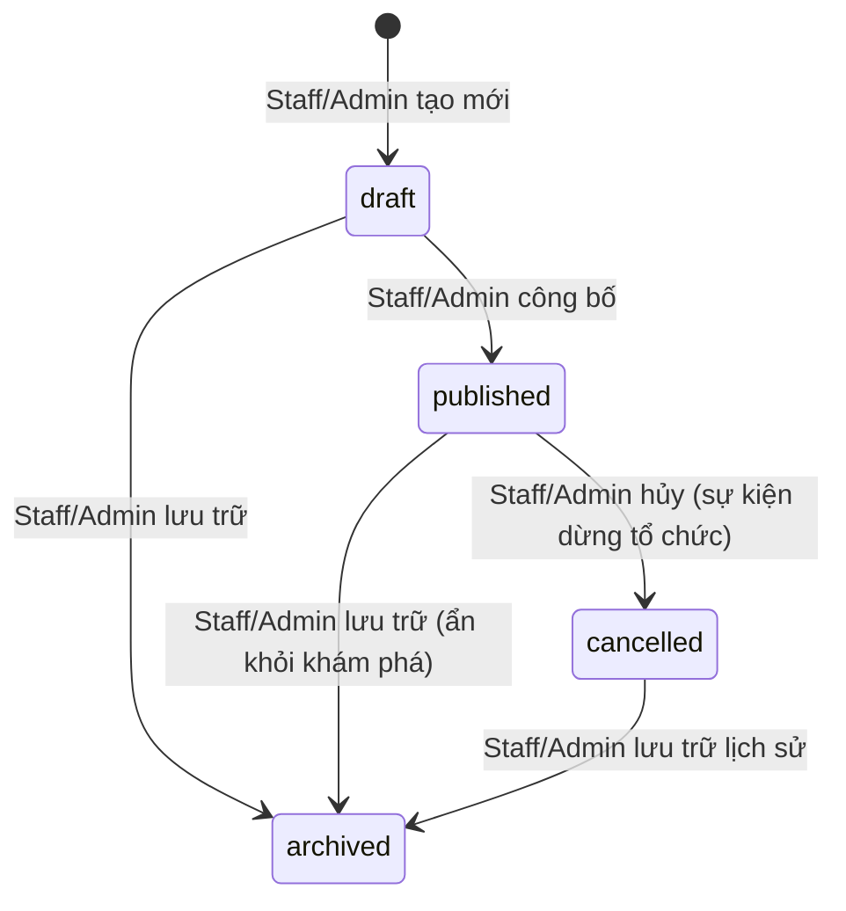
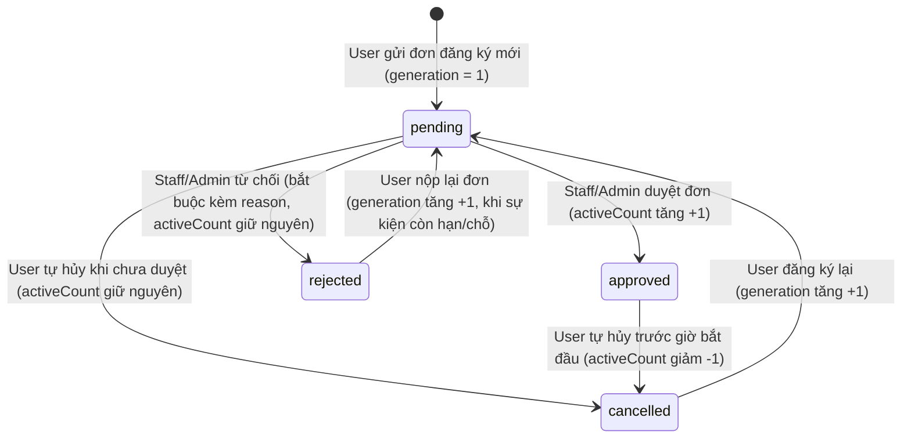

# Mô hình Dữ liệu Cloud Firestore (`docs/data-model.md`)

> **Căn cứ yêu cầu**: Đề Final Assignment — Mục 6 (Backend requirements) & Phụ lục A (Appendix A — Data model template).  
> **Nguyên tắc hệ thống**: Hệ thống không sử dụng custom server hay Cloud Functions; toàn bộ việc phân quyền, kiểm tra tính toàn vẹn dữ liệu và chuyển đổi trạng thái được kiểm soát trực tiếp bởi **Firestore Security Rules** (`firebase/firestore.rules`) kết hợp logic client (`mobile/`, `web/`, `packages/core/`).

---

## 1. Hệ thống Phân vai & Nguyên tắc Truy cập (`Roles & Access Control`)

Vai trò người dùng được lưu trữ tại trường `role` của tài liệu `users/{uid}`.
- `user`: Sinh viên / Người tham gia sự kiện (chỉ sử dụng **Mobile App**).
- `staff`: Trưởng Câu lạc bộ (sử dụng **Web Admin**, phạm vi thao tác bị giới hạn bởi `users/{uid}.clubId`).
- `admin`: Quản trị viên hệ thống (sử dụng **Web Admin**, có toàn quyền quản trị và phân vai).

### Nguyên tắc Bất biến (`Invariants`)
1. Tài khoản Admin đầu tiên được khởi tạo trực tiếp trên Firebase Console và ghi rõ trong `README.md`.
2. Chỉ `admin` mới có quyền thay đổi `role` và `clubId` của người khác.
3. Không ai (kể cả `admin`) được phép tự thay đổi `role` của chính mình (`request.auth.uid != targetUid`).
4. Khách vãng lai (`guest`) và sinh viên (`student`) dùng chung role `user`; sự khác biệt nằm ở trường tự khai `participant.group` trong từng đơn đăng ký.

---

## 2. Bảng Đặc tả Collection Firestore (Chuẩn Appendix A)

| Collection / Sub-collection | Các trường chính (Key fields & Types) | Create (Tạo mới) | Read (Đọc) | Update (Cập nhật) | Delete (Xóa) | Màn hình sử dụng (Screens) |
|---|---|---|---|---|---|---|
| `users/{uid}` | `role` (string: `'user'`, `'staff'`, `'admin'`), `displayName` (string), `email` (string), `clubId` (string?), `createdAt` (timestamp), `updatedAt` (timestamp?) | Tự tạo khi đăng nhập lần đầu (`self`), mặc định gán `role = 'user'` | `self` đọc hồ sơ của mình; `admin` đọc toàn bộ; `staff` đọc qua đơn đăng ký | Chỉ `admin` được đổi `role` & `clubId` (không tự đổi của mình); `self` chỉ đổi `displayName` | Bị cấm (`allow delete: if false`) | **Mobile**: `A10 AccountTabScreen`, `ProfileEditScreen`. **Web**: `AdminUsersScreen`, `AppShell`. |
| `clubs/{clubId}` | `name` (string), `shortName` (string), `description` (string), `status` (string: `'active'`, `'archived'`), `createdAt` (timestamp), `updatedAt` (timestamp) | Chỉ `admin` | Mọi user đã xác thực (`member()`) | Chỉ `admin` | Bị cấm (chuyển sang `archived` thay vì xóa) | **Mobile**: Bộ lọc `A02/A03`. **Web**: `AdminClubsScreen`. |
| `events/{eventId}` | `title` (string <= 120), `clubId` (string), `clubName` (string), `location` (string), `startsAt` (timestamp), `endsAt` (timestamp), `deadline` (timestamp?), `description` (string), `topic` (string), `coverKey` (string), `registrationMode` (string: `'required'`, `'free'`), `visibility` (string: `'public'`, `'unlisted'`), `status` (string: `'draft'`, `'published'`, `'cancelled'`, `'archived'`), `capacity` (int), `activeCount` (int), `updatedAt` (timestamp) | `staff` (cho CLB của mình) hoặc `admin` | Người dùng đã đăng nhập đọc sự kiện `published` & `public`; `staff` đọc sự kiện của CLB mình; `admin` đọc tất cả | `staff` cập nhật nội dung sự kiện CLB; `user` chỉ được tăng/giảm `activeCount +/- 1` thông qua transaction đăng ký/hủy hợp lệ | Bị cấm (chuyển sang `cancelled` hoặc `archived`) | **Mobile**: `A02 Discover`, `A03 Search`, `A04 EventDetail`. **Web**: `ClubEventsScreen`, `LiveQrPanelScreen`. |
| `registrations/{uid}_{eventId}` | `uid` (string), `eventId` (string), `clubId` (string), `status` (string: `'pending'`, `'approved'`, `'rejected'`, `'cancelled'`), `generation` (int), `participant` (map: `name`, `email`, `group`, `cohort`, `organization`, `phone`), `reason` (string?), `reviewedBy` (string?), `reviewedAt` (timestamp?), `checkInAt` (timestamp?), `qrHash` (string?), `createdAt` (timestamp), `lastOperationId` (string: 48 hex) | `user` tạo đơn của chính mình (với `status = 'pending'`, sự kiện còn hạn/chỗ) | Chủ đơn (`uid == auth.uid`), `staff` cùng `clubId`, hoặc `admin` | `user` hủy đơn của mình (`cancelled`) hoặc check-in (`checkInAt`); `staff`/`admin` duyệt (`approved`) hoặc từ chối (`rejected` kèm `reason`) | Bị cấm (`allow delete: if false`) | **Mobile**: `A05 Register`, `A06 Success`, `A07 Schedule`, `A08 Detail`, `A11 Scan`, `A12 Result`. **Web**: `ReviewQueueScreen`, `LiveQrPanelScreen`. |
| `checkinSessions/{eventId}` | `eventId` (string), `clubId` (string), `open` (bool), `updatedBy` (string), `updatedAt` (timestamp) | `staff` (CLB sở hữu sự kiện) hoặc `admin` | Mọi user đã xác thực (để kiểm tra phiên khi quét QR) | `staff` cùng `clubId` hoặc `admin` (mở/đóng phiên) | Bị cấm | **Mobile**: `A11 ScannerScreen`. **Web**: `LiveQrPanelScreen`. |
| `qrCredentials/{qrHash}` | `eventId` (string), `clubId` (string), `enabled` (bool), `createdBy` (string), `createdAt` (timestamp) | `staff` (CLB sở hữu) hoặc `admin` (khi tạo/xoay mã QR mới) | Bị cấm đọc trực tiếp (`allow list: if false`; Security Rules dùng `get()` xác thực mã khi check-in) | `staff` cùng `clubId` hoặc `admin` (vô hiệu mã) | Bị cấm | **Web**: `LiveQrPanelScreen`. |
| `announcements/{announcementId}` | `title` (string <= 120), `body` (string <= 1000), `scope` (string: `'global'`, `'club'`, `'event'`), `clubId` (string?), `clubName` (string?), `eventId` (string?), `authorUid` (string), `authorRole` (string: `'staff'`, `'admin'`), `createdAt` (timestamp) | `staff` (cho CLB/sự kiện của mình); `admin` (toàn hệ thống hoặc bất kỳ CLB nào) | Mọi user đã xác thực | `staff` (sửa thông báo của CLB mình); `admin` | Chỉ `admin` hoặc tác giả `staff` | **Mobile**: `A09 NotificationsTabScreen`. **Web**: `ClubAnnouncementsScreen`. |
| `users/{uid}/notifications/{id}` | `title` (string), `body` (string), `type` (string), `eventId` (string), `registrationId` (string?), `createdAt` (timestamp), `readAt` (timestamp?) | Hệ thống/Transaction ghi khi duyệt/từ chối đơn hoặc đổi lịch | Chỉ chính chủ `uid` (`request.auth.uid == uid`) | Chỉ chính chủ `uid` (chỉ cập nhật trường `readAt = request.time`) | Bị cấm | **Mobile**: `A09 NotificationsTabScreen`. |
| `users/{uid}/devices/{deviceId}` | `fid` (string < 4096), `platform` (string: `'android'`, `'web'`), `updatedAt` (timestamp) | Chính chủ `uid` đăng ký token FCM | Chính chủ `uid` | Chính chủ `uid` | Chính chủ `uid` khi đăng xuất | **Mobile**: `FirebaseCloudServices`. |

---

## 3. Quy tắc Chuyển đổi Trạng thái Hợp lệ (`Allowed Status Transitions`)

Mọi bước chuyển trạng thái đều được kiểm tra chặt chẽ trong `firebase/firestore.rules`:

### 3.1. Sự kiện (`events.status`)

- **Quyền hạn**: Chỉ `staff` sở hữu sự kiện hoặc `admin` được đổi trạng thái sự kiện. `user` không có quyền thay đổi trạng thái sự kiện.

### 3.2. Đơn đăng ký (`registrations.status`)

- **Quy tắc ràng buộc nguyên tử (`Atomic Invariants`)**:
  - Khi `pending -> approved`: Transaction bắt buộc tăng `events/{eventId}.activeCount + 1` và bảo đảm `activeCount <= capacity`.
  - Khi `approved -> cancelled`: Transaction bắt buộc giảm `events/{eventId}.activeCount - 1` (chỉ cho phép khi sự kiện chưa bắt đầu và chưa điểm danh).
  - Khi `pending -> rejected`: Bắt buộc `reason` có độ dài từ 3 đến 300 ký tự; `activeCount` không thay đổi.
  - Điểm danh (`checkInAt`): Chỉ cho phép khi đơn đang `approved`, `checkInAt == null`, mã băm `qrHash` khớp với `qrCredentials` hợp lệ và `checkinSessions.open == true`.

---

## 4. Kiểm thử Mô hình Dữ liệu & Security Rules

Toàn bộ các trường, quy tắc phân vai và kịch bản chuyển đổi trạng thái nêu trên được kiểm chứng tự động bằng bộ kiểm thử Firestore Emulator tại `firebase/tests/direct-firestore.test.js` với ít nhất 1 ca `Allowed` và 1 ca `Denied` cho từng role trên từng collection.
