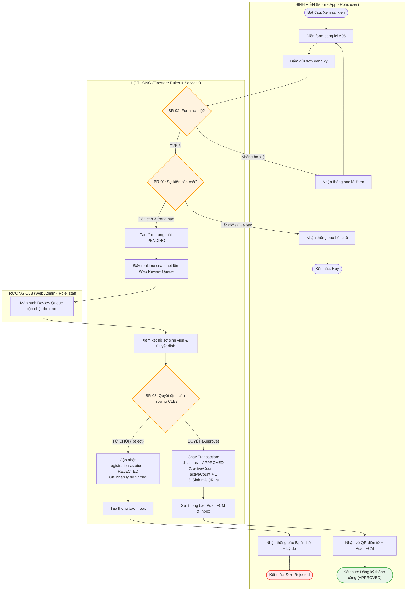

# ĐẶC TẢ LUỒNG NGHIỆP VỤ (WORKFLOW SPECIFICATION) — DỰ ÁN EVENTHUB
## Bám sát bộ khung Software Project Presentation Guideline V3 (Theo chuẩn chuyên đề Workflow W01 – W15)

---

## PHẦN 1: CƠ SỞ LÝ THUYẾT VỀ WORKFLOW TRONG ĐỒ ÁN PHẦN MỀM

### 1. Workflow là gì?
> **Định nghĩa chuẩn (W03):**  
> **Workflow (Luồng nghiệp vụ)** là một chuỗi bước có thứ tự, do một hoặc nhiều actor cùng hệ thống thực hiện, bắt đầu bằng một **Trigger** và kết thúc bằng một **Kết quả nghiệp vụ có giá trị, quan sát được**; trên đường đi, dữ liệu hoặc trạng thái của đối tượng nghiệp vụ thay đổi theo **Business Rule (BR)**.
> 
> *Nói ngắn gọn:* **Ai làm gì, theo thứ tự nào, để đạt kết quả gì** — không phải *"người dùng bấm những nút nào"*.

```
┌──────────────┐     ┌───────────────────────┐     ┌───────────────────────┐     ┌──────────────┐
│   TRIGGER    │ ──► │  BƯỚC & QUYẾT ĐỊNH   │ ──► │  THAY ĐỔI TRẠNG THÁI  │ ──► │   KẾT QUẢ    │
│ Sự kiện khởi │     │ Actor A / Hệ thống /  │     │ Đối tượng nghiệp vụ   │     │ Actor nhận   │
│     động     │     │ Actor B (theo BR)     │     │ DRAFT ➔ PENDING ➔ ... │     │   giá trị    │
└──────────────┘     └───────────────────────┘     └───────────────────────┘     └──────────────┘
```

---

### 2. Sợi Chỉ Nối Toàn Bộ Đồ Án (Traceability Thread)
Workflow là trục xương sống liên kết toàn bộ các tài liệu và slide kỹ thuật (W02):
- **Slide 06:** Nhóm Yêu cầu chức năng (FR) thành các Workflow lõi.
- **Slide 08:** Sơ đồ hoạt động phân làn (Activity Diagram with Swimlanes / BPMN).
- **Slide 09:** Sơ đồ trạng thái đối tượng nghiệp vụ (State Machine).
- **Slide 12:** Sơ đồ tuần tự phối hợp giữa các thành phần (Sequence Diagram).
- **Slide 13:** Thiết kế giao diện (UI Prototype) bám sát các bước trong Workflow.
- **Slide 19:** Ma trận truy vết (Traceability Matrix: `FR` $\leftrightarrow$ `BR` $\leftrightarrow$ `WF` $\leftrightarrow$ `TC`).
- **Slide 21:** Kịch bản Demo bám theo câu chuyện End-to-End của từng Workflow.
- **Slide 22:** Kiểm thử tự động (Test Cases) kiểm tra từng nhánh rẽ và Business Rule của Workflow.

---

### 3. Bộ 7 Thành Phần Cốt Lõi Của Một Workflow Đầy Đủ (W04)
Mỗi Workflow được định nghĩa đầy đủ qua 7 yếu tố:
1. **Mã & Tên (`WF-__`):** Đặt theo mẫu `Động từ + Đối tượng nghiệp vụ` (Ví dụ: *WF-01 · Đăng ký và xét duyệt vé tham gia sự kiện*).
2. **Actor:** Ai tham gia vào luồng? (Cả con người và các hệ thống tự động).
3. **Trigger:** Sự kiện cụ thể nào kích hoạt luồng bắt đầu?
4. **Precondition:** Điều kiện tiên quyết nào phải đúng trước khi luồng chạy?
5. **Bước & Quyết định (Happy Path + BR):** Trình tự các bước thực hiện và các điểm rẽ nhánh theo Business Rule.
6. **Kết quả (Postcondition):** Trạng thái đối tượng nghiệp vụ thay đổi như thế nào, actor nhận được giá trị gì?
7. **Exception:** Khi có lỗi, vi phạm quy tắc hoặc dữ liệu không hợp lệ thì xử lý ra sao?

---

### 4. Năm Câu Hỏi Kiểm Tra Nhanh (5/5 tiêu chí đạt chuẩn - W05)
1. **Có Trigger rõ ràng không?** $\rightarrow$ Có (Sinh viên bấm gửi đơn, Trưởng CLB mở phiên điểm danh).
2. **Có kết thúc bằng kết quả nghiệp vụ có giá trị không?** $\rightarrow$ Có (Sinh viên nhận vé QR hợp lệ, Trưởng CLB có danh sách điểm danh). *Không dừng lại ở "Mở được màn hình X"*.
3. **Có thay đổi dữ liệu / trạng thái hoặc một quyết định?** $\rightarrow$ Có (Đơn chuyển từ `DRAFT` $\rightarrow$ `PENDING` $\rightarrow$ `APPROVED` hoặc `REJECTED`; `activeCount` nhảy số).
4. **Có điểm rẽ nhánh theo Business Rule hoặc nhánh ngoại lệ?** $\rightarrow$ Có (Kiểm tra còn chỗ `BR-01`, kiểm tra form `BR-02`, quyền xét duyệt `BR-03`).
5. **Diễn đạt được bằng ngôn ngữ nghiệp vụ, không cần tên nút?** $\rightarrow$ Có (Mô tả hành vi nghiệp vụ sinh viên và cán bộ, không mô tả thao tác click chuột).

---

### 5. Phân Biệt Workflow Với Các Khái Niệm Thường Nhầm Lẫn (W06 & W07)

| Khái niệm | Mô tả cái gì? | Điểm khác biệt với Workflow | Đặt ở đâu trong đồ án? |
|---|---|---|---|
| **Workflow** | Chuỗi bước xuyên actor từ trigger đến kết quả có giá trị nghiệp vụ | Trục nối xuyên suốt toàn bộ hệ thống | Mục Kiến trúc & Nghiệp vụ |
| **Feature / FR** | Năng lực hệ thống làm được | Một Workflow phối hợp nhiều Feature | Danh sách FR |
| **Use Case** | Mục tiêu của 1 actor trong 1 lần tương tác | Một Workflow có thể gồm nhiều Use Case | Use Case Diagram |
| **User Flow** | Đường đi qua các màn hình giao diện (UI click chain) | Chỉ mô tả hành vi người dùng trên app, không có quyết định nghiệp vụ backend | Mục UI/UX Design |
| **State Machine** | Vòng đời biến chuyển trạng thái của một đối tượng dữ liệu | Workflow làm đối tượng chuyển trạng thái | State Diagram |
| **Sequence Diagram** | Sự phối hợp giữa các layer bên trong hệ thống (Client, Notifier, Service, Database) | Mô tả chi tiết kỹ thuật "bên trong" một bước của Workflow | Mục Thiết kế Kỹ thuật |

---

## PHẦN 2: ĐẶC TẢ CHI TIẾT CÁC WORKFLOW LÕI TRONG DỰ ÁN EVENTHUB

Hệ thống **EventHub** lựa chọn **2 Workflow lõi vừa cỡ (3–7 bước, có rẽ nhánh theo Business Rule, giải quyết đúng Pain Point của dự án)**:
* **`WF-01`**: Đăng ký và xét duyệt vé tham gia sự kiện (Core Cross-Role Flow).
* **`WF-02`**: Mở phiên và điểm danh sự kiện bằng mã QR (Bonus Realtime Flow).

---

### ĐẶC TẢ WORKFLOW LÕI 1: WF-01 · ĐĂNG KÝ VÀ XÉT DUYỆT VÉ THAM GIA SỰ KIỆN

#### 1. Bảng Đặc Tả Chuẩn (Mẫu W10 / W11)

| Thuộc tính | Nội dung chi tiết |
|---|---|
| **Mã & Tên** | **`WF-01 · Đăng ký và xét duyệt vé tham gia sự kiện`** |
| **Actor** | 1. **Sinh viên** (`user` trên Flutter Mobile App)<br>2. **Trưởng CLB** (`staff` trên Flutter Web Admin)<br>3. **Hệ thống Cloud Firestore & Firebase Messaging (FCM)** |
| **Trigger** | Sinh viên chọn sự kiện và bấm gửi đơn đăng ký tham gia trên ứng dụng di động |
| **Precondition** | 1. Tài khoản Sinh viên đã đăng nhập và xác thực email.<br>2. Sự kiện đang ở trạng thái `status == 'published'` và chưa quá hạn đăng ký (`now < deadline`).<br>3. Sự kiện còn chỉ tiêu đăng ký: `events/{id}.activeCount < capacity` (BR-01).<br>4. Sinh viên chưa có đơn đăng ký hợp lệ đang xử lý cho sự kiện này. |
| **Postcondition** | 1. Đơn đăng ký chuyển sang trạng thái cuối: `APPROVED` (Đã duyệt) hoặc `REJECTED` (Bị từ chối).<br>2. Nếu `APPROVED`: Số lượng `activeCount` tăng nguyên tử `+1`, sinh vé QR điện tử có chữ ký bảo mật.<br>3. Sinh viên nhận thông báo kết quả tức thời qua **FCM Push Notification** và hòm thư **Inbox**. |
| **Truy vết (Traceability)** | **FR-01..04** (Tìm kiếm, Đăng ký, Duyệt đơn) &bull; **BR-01, BR-02, BR-03** &bull; **UI-04, UI-05, UI-08, Web-02** &bull; **FirestoreEventService** &bull; **TC01–TC08** |

#### 2. Trình Tự Thực Hiện (Happy Path)
1. **Sinh viên:** Mở chi tiết sự kiện `A04`, kiểm tra thông tin, điền form đăng ký `A05` (Khóa sinh viên, lý do tham gia, cam kết tham dự) và gửi đơn.
2. **Hệ thống (Mobile App & Firestore Rules):** Kiểm tra tính hợp lệ của dữ liệu đầu vào (`BR-02`) và đối chiếu sức chứa sự kiện (`BR-01`). Bản ghi đăng ký được tạo tại `registrations/{uid}_{eventId}` với trạng thái ban đầu là `PENDING`.
3. **Hệ thống (Web Admin Stream):** Đồng bộ đơn mới theo thời gian thực (Realtime Snapshot Stream) vào màn hình **Review Queue** trên Web Admin của Trưởng CLB cùng thông báo số đơn chờ duyệt.
4. **Trưởng CLB:** Mở hàng đợi duyệt, xem xét hồ sơ sinh viên và đưa ra quyết định duyệt (`APPROVE`).
5. **Hệ thống (Firestore Transaction):** Chạy transaction nguyên tử:
   - Cập nhật `registrations/{id}.status = 'approved'`.
   - Tăng `events/{eventId}.activeCount` lên 1 đơn vị.
   - Sinh vé QR Code và tạo thông báo tại `users/{uid}/notifications/{notifId}`.
6. **Sinh viên:** Ứng dụng di động tự động cập nhật màn hình `A07` sang vé `ĐÃ DUYỆT`, hiển thị mã QR check-in và nhận thông báo đẩy FCM.

#### 3. Các Điểm Quyết Định Theo Business Rule & Nhánh Ngoại Lệ (Exception Path)

| Mã BR | Tên Business Rule | Điểm quyết định | Nhánh Happy Path | Nhánh Ngoại lệ (Exception) & Xử lý | Test Case tương ứng |
|---|---|---|---|---|---|
| **BR-01** | *Quy tắc sức chứa và hạn chót* | Khi gửi đơn, kiểm tra `deadline` và `activeCount < capacity` | Còn chỗ & chưa hết hạn $\rightarrow$ Tiếp tục bước 2 | **Hết chỗ:** Hệ thống chặn gửi đơn, báo *"Sự kiện đã đủ số lượng tham gia"*. Chuyển sang danh sách chờ nếu có. | `TC01` (Còn chỗ)<br>`TC02` (Hết chỗ bị chặn) |
| **BR-02** | *Quy tắc tính hợp lệ của Form* | Kiểm tra khóa K sinh viên (`k17`, `k18`, `k19`) và thông tin liên hệ | Thông tin hợp lệ $\rightarrow$ Tạo đơn `PENDING` | **Thiếu thông tin / Sai khóa:** Form báo đỏ tại trường nhập liệu, nút Gửi bị vô hiệu hóa. | `TC03` (Form chuẩn)<br>`TC04` (Form thiếu trường) |
| **BR-03** | *Quy tắc thẩm quyền xét duyệt* | Chỉ tài khoản có `role == 'staff'` và cùng `clubId` với sự kiện mới có quyền duyệt | Trưởng CLB duyệt $\rightarrow$ Chuyển `APPROVED`, tăng `activeCount + 1` | **Từ chối (Reject):** Bắt buộc nhập lý do từ chối. Đơn sang `REJECTED`, `activeCount` giữ nguyên, gửi thông báo kèm lý do cho sinh viên. | `TC05` (Staff duyệt)<br>`TC06` (Staff từ chối)<br>`TC07` (User duyệt lậu $\rightarrow$ Chặn) |

---

### 4. Sơ Đồ Hoạt Động Phân Làn (Activity Diagram with Swimlanes - WF-01)



---

### 5. Từ Workflow Sang State Machine Đối Tượng `Registration` (W13)

Vòng đời của thực thể đăng ký (`Registration Entity`) được dẫn dắt trực tiếp bởi các bước trong `WF-01`:

```
   [DRAFT] 
      │  (Sinh viên điền form & submit thỏa BR-01, BR-02)
      ▼
  [PENDING] (Chờ Trưởng CLB xét duyệt trên Web Queue)
      │
      ├─────────────────────────────────────────┐
      │ (Trưởng CLB Duyệt thỏa BR-03)           │ (Trưởng CLB Từ chối có lý do BR-03)
      ▼                                         ▼
 [APPROVED] ────────────────────────────►  [REJECTED]
      │  (Được cấp vé QR, activeCount +1)        (Giữ nguyên activeCount, lưu lý do)
      │
      │  (Khi tham gia sự kiện - WF-02)
      ▼
 [ATTENDED] (Đã quét mã QR check-in tại hội trường)
```

| Bước của WF-01 | Chuyển trạng thái | Business Rule kiểm soát | Test Case kiểm thử tự động |
|---|---|---|---|
| **Sinh viên gửi đơn đăng ký** | `DRAFT → PENDING` | `BR-01` (Còn chỗ) & `BR-02` (Đủ thông tin) | `TC01` (Tạo đơn hợp lệ)<br>`TC02` (Hết chỗ chặn tạo đơn) |
| **Trưởng CLB phê duyệt đơn** | `PENDING → APPROVED` | `BR-03` (`role == 'staff'`, cùng `clubId`) | `TC05` (Duyệt thành công, `activeCount` tăng 1) |
| **Trưởng CLB từ chối đơn** | `PENDING → REJECTED` | `BR-03` (Bắt buộc có chuỗi `reason.size() > 0`) | `TC06` (Từ chối thành công, kèm lý do) |
| **Chuyển trạng thái bị cấm** | `DRAFT → APPROVED` | Không được bỏ qua bước duyệt của CLB | `TC08` (Cố tình gọi API update bypass bị chặn) |
| **Chuyển trạng thái bị cấm** | `REJECTED → APPROVED` | Đơn bị từ chối không được tự ý kích hoạt lại | `TC09` (Security Rules chặn thao tác tái kích hoạt) |

---

## PHẦN 3: ĐẶC TẢ WORKFLOW MỞ RỘNG: WF-02 · MỞ PHIÊN & ĐIỂM DANH SỰ KIỆN BẰNG MÃ QR

| Thuộc tính | Nội dung chi tiết |
|---|---|
| **Mã & Tên** | **`WF-02 · Mở phiên & điểm danh sự kiện bằng mã QR`** |
| **Actor** | 1. **Trưởng CLB** (`staff` trên Flutter Web Admin)<br>2. **Sinh viên** (`user` trên Flutter Mobile App)<br>3. **Dịch vụ Camera QR & Cloud Firestore Security Rules** |
| **Trigger** | Trưởng CLB kích hoạt nút "Mở phiên điểm danh" trên Web Admin tại hội trường sự kiện |
| **Precondition** | 1. Sự kiện đang diễn ra (`status == 'ongoing'` hoặc trong khung giờ tổ chức).<br>2. Sinh viên đã có đơn đăng ký trạng thái `APPROVED` (WF-01).<br>3. Thiết bị sinh viên được cấp quyền truy cập Camera (`CAMERA_PERMISSION`). |
| **Postcondition** | 1. Đơn đăng ký chuyển từ `APPROVED → ATTENDED`.<br>2. Lưu vết mốc thời gian máy chủ `checkInAt = serverTimestamp()`.<br>3. Bảng điểm danh thời gian thực trên Web Admin tự động nhảy số sinh viên có mặt. |
| **Quy tắc & Ngoại lệ** | &bull; **BR-04 (Mã QR hợp lệ):** Mã QR được mã hóa băm SHA-256 từ `eventId + secretKey + sessionId`. Nếu quét sai sự kiện $\rightarrow$ Báo lỗi *"Mã QR không hợp lệ"*.<br>&bull; **BR-05 (Chống điểm danh trùng):** Nếu sinh viên đã có `checkInAt != null` $\rightarrow$ Hệ thống chặn và hiển thị *"Bạn đã điểm danh lúc HH:mm"*, không tạo thêm lượt điểm danh mới. |

---

## PHẦN 4: BẢNG CHECKLIST TỰ KIỂM TRA WORKFLOW (Theo chuẩn W14)

Trước khi bảo vệ trước Hội đồng, nhóm đã tự rà soát theo đúng 8 tiêu chí kiểm tra:
- [x] **1. Đạt 5/5 câu hỏi kiểm tra nhanh:** Cả 2 WF đều có trigger rõ ràng, kết thúc bằng kết quả có giá trị, có đối tượng đổi trạng thái, có rẽ nhánh BR và diễn đạt bằng ngôn ngữ nghiệp vụ.
- [x] **2. Số lượng vừa cỡ:** Chọn 2 WF lõi cốt lõi (WF-01 Đăng ký/Xét duyệt, WF-02 Điểm danh QR), mỗi WF có 4–6 bước, giải quyết trực tiếp bài toán quản lý sự kiện của sinh viên FPT.
- [x] **3. Đặt tên đúng chuẩn:** Tên đều theo mẫu `Động từ + Đối tượng nghiệp vụ`. Không chứa từ cấm như *"Màn hình"*, *"Module"*, *"Quản lý"*.
- [x] **4. Đầy đủ 7 thành phần:** Có đủ Mã, Actor, Trigger, Precondition, Bước & BR, Kết quả, Exception.
- [x] **5. Điểm quyết định ghi mã BR rõ ràng:** Trên sơ đồ đều gắn mã quy tắc nghiệp vụ `BR-01, BR-02, BR-03`.
- [x] **6. Postcondition khớp State Machine:** Trạng thái `PENDING → APPROVED / REJECTED` khớp 100% với sơ đồ vòng đời thực thể `Registration`.
- [x] **7. Mỗi nhánh rẽ có Test Case tương ứng:** Các nhánh rẽ đều có mã test tự động từ `TC01` đến `TC09` trong bộ ARTEMIS Test Suite.
- [x] **8. Demo trùng khớp Workflow đã thiết kế:** Kịch bản demo video và bảo vệ trực tiếp thực hiện đúng theo luồng WF-01 (Sinh viên đăng ký $\rightarrow$ Web Admin duyệt $\rightarrow$ Sinh viên nhận vé QR).

