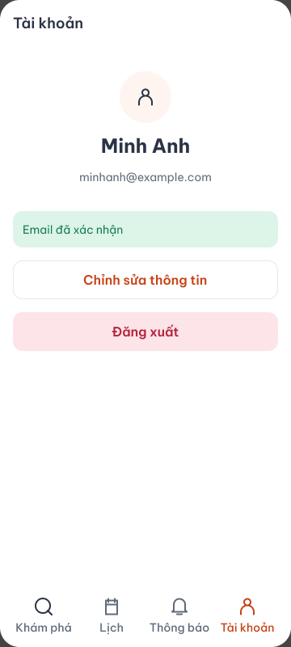
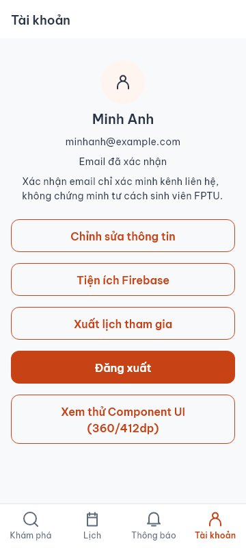

# A10 — đối chiếu trước/sau

Ngày ghi nhận: 01/11/2026.

- Trước: export từ [Figma Lab 2](https://www.figma.com/design/WC21Na9ZDS8jjM2LzPKeXa?node-id=181-1982) node `181:1982`.
- Sau: widget Flutter thật với dữ liệu UI fixture, chụp bằng `tool/capture_design_evidence_test.dart`, 360 × 800. Đây không phải bằng chứng cloud.
- Thay đổi/lý do: Thêm truy cập công cụ Firebase và xuất PDF để phục vụ Lab 3; email hồ sơ phản ánh đúng Firebase provider.
- Trạng thái: chưa đồng bộ thay đổi lên Figma, chưa coi là được duyệt.

