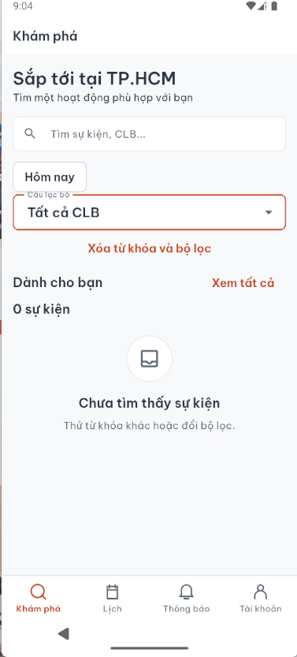
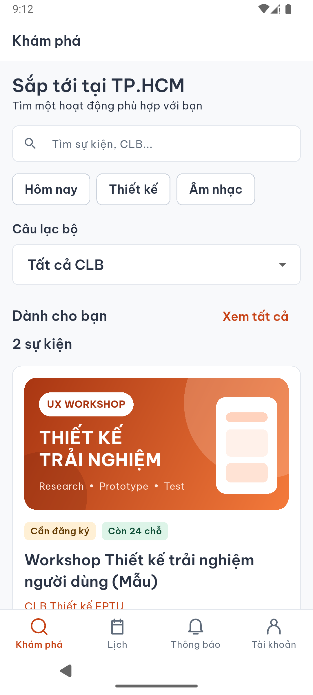

# D11 — Khám phá: bộ lọc và dữ liệu mẫu

01/11/2026. Theo yêu cầu người dùng sửa màn Khám phá và thêm dữ liệu để xem UI.

- Tách nhãn CLB khỏi outline, thêm khoảng cách chip/selector/section để tránh chữ đè viền.
- Chỉ hiện xóa từ khóa/bộ lọc khi có điều kiện đang áp dụng.
- Nguồn rỗng dùng “Chưa có sự kiện”; tìm kiếm không khớp dùng “Chưa tìm thấy sự kiện”.
- Thêm hai document `events/demo-ux-workshop` và `events/demo-acoustic` vào project eventhub-group4 với tiền tố ID demo, title (Mẫu), isDemo=true và mô tả minh họa. Chỉ create nếu chưa có; không sửa dữ liệu thật, không tạo registration/QR/session.
- Ngày sự kiện mẫu 08–09/11/2026 để có thể xem trạng thái sắp tới; không thay đổi bộ dữ liệu Lab 2 đã duyệt. Snapshot nguồn: `../../../firebase/demo-events.json`.
- Chưa sửa Figma; cần đồng bộ thay đổi bố cục sau khi người dùng duyệt.

Kiểm tra: analyze sạch; 3/3 layout tests pass; Android debug build/cài thành công. Ảnh sau là emulator đọc hai event mẫu từ Firestore thật, dùng artwork editable đã có trong app, không phải ảnh chèn giả danh sách.
