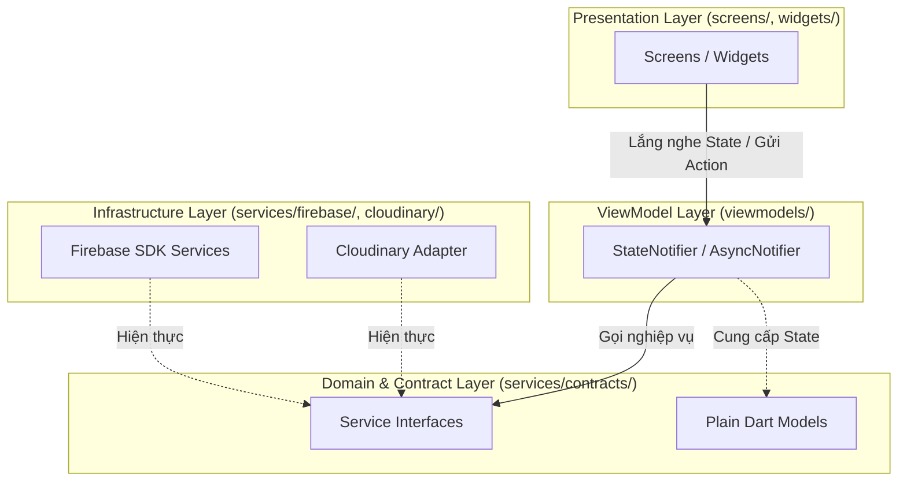

# BÁO CÁO TỔNG KẾT ĐỒ ÁN LAB 3 — PRM393
## Ứng dụng Di động Kết nối Đám mây: EventHub (Firebase, Google ARTEMIS, AI Code Review)

> **Môn học**: PRM393 — Mobile Programming  
> **Nhóm thực hiện**: Group 4  
> **Dự án Firebase**: `eventhub-group4` (Application ID: `com.eventhub.app`)  
> **Mã nguồn**: `PRM393_Lab03_Group4`  
> **Tài liệu tham chiếu**: Đề bài Lab 3 (Mục 3–11), `docs/design-traceability.md`, `docs/architecture.md`, `docs/analytics-plan.md`, `docs/test-plan.md`, `docs/code-review.md`.

---

## 1. TỔNG QUAN DỰ ÁN & BỐI CẢNH LAB 2

### 1.1. Bối cảnh & Mục tiêu Sản phẩm
**EventHub** là ứng dụng di động Flutter trên nền tảng Android dành cho sinh viên trường Đại học FPT phân hiệu TP.HCM và khách vãng lai, phục vụ việc tìm kiếm, đăng ký giữ chỗ và điểm danh tham gia các sự kiện, hội thảo do các Câu lạc bộ (CLB) tổ chức.

### 1.2. Ba Persona Mục tiêu & Tiêu chí Thành công Lab 2
1. **P01 — Nguyễn Minh Anh (Sinh viên K18 FPTU TP.HCM)**:
   - *Nhu cầu*: Tìm sự kiện học thuật/workshop công nghệ, đăng ký giữ chỗ nhanh trước khi hết suất, quét mã QR điểm danh tại hội trường để nhận chứng nhận.
   - *Ràng buộc*: Bắt buộc khai báo Khóa K (`cohort`); không thu thập mã số sinh viên, CCCD hay email trường.
   - *Tiêu chí thành công Lab 2*: Thời gian từ khi mở app đến khi đăng ký thành công $\le 90$ giây; thời gian quét QR và nhận biên nhận $\le 30$ giây trong điều kiện mạng ổn định.
2. **P02 — Gia Linh (Khách tham dự ngoài trường)**:
   - *Nhu cầu*: Tham gia các workshop mở mà không bị ép buộc thông tin sinh viên FPTU.
   - *Hiện thực*: Biểu mẫu đăng ký tự động ẩn trường Khóa K khi chọn nhóm `guest`, cho phép nhập Tên trường/Đơn vị công tác tùy chọn.
3. **P03 — Việt Khoa (Người tham gia sự kiện tự do)**:
   - *Nhu cầu*: Xem thời gian, địa điểm các đêm nhạc, ngày hội mở cửa tự do (`registrationMode == 'free'`).
   - *Hiện thực*: Không có nút đăng ký hay quét QR; sinh viên đọc thông tin $\le 60$ giây.

---

## 2. TRUY VẾT THIẾT KẾ & ĐỐI CHIẾU FIGMA (`DESIGN TRACEABILITY`)

Ứng dụng hiện thực trọn vẹn **12 màn hình từ thiết kế Final UI Lab 2 (`A01`–`A12`)** và bổ sung 2 màn hình phục vụ tính năng đám mây Lab 3:

| Mã màn | Tên màn hình trong Code | Route | Nguồn dữ liệu | Hành vi & Trạng thái UI bắt buộc |
|---|---|---|---|---|
| `A01a–d` | `AuthScreen` | `/auth/*` | Firebase Auth | Đăng nhập Google, Email/Password, Gửi xác minh email (`verify`), Quên mật khẩu (`reset`). Xử lý hủy Google picker, sai mật khẩu, mất mạng. |
| `A02` | `EventListScreen` | `/discover` | Firestore `events` | Danh sách sự kiện mở, thẻ gợi ý điều khiển động bằng Remote Config. Giữ vị trí cuộn khi quay lại. |
| `A03` | `EventListScreen(search: true)` | `/discover/search` | Firestore `events` | Tìm kiếm từ khóa, bộ lọc CLB/chủ đề/ngày. Đủ trạng thái `loading`, `empty` (kèm xóa lọc), `error`. |
| `A04` | `EventDetailScreen` | `/events/:id` | Firestore `events` | Phân biệt rõ sự kiện cần đăng ký (`required`) và tự do (`free`). Khóa nút khi hết chỗ, quá hạn, hoặc đã bắt đầu. |
| `A05` | `RegistrationFormScreen` | `/events/:id/register` | `BookingViewModel` | Form tự khai sinh viên/khách. Bắt buộc khóa K với sinh viên. Chống gửi lặp bằng `operationId`. |
| `A06` | `RegistrationDetailScreen(success: true)` | `/registrations/:id/success` | `RegistrationService` | Xác nhận đăng ký máy chủ. Không hiển thị mã QR cá nhân giả lập. |
| `A07` | `LiveScheduleScreen` | `/schedule` | Firestore `registrations` | 3 tab: Sắp tới, Đã kết thúc, Đã hủy. Phân biệt rõ nhãn 'Đã hủy đăng ký' (user hủy) và 'Sự kiện đã hủy' (CLB hủy). |
| `A08` | `RegistrationDetailScreen` | `/registrations/:id` | `RegistrationService` | Chi tiết đăng ký, nút Hủy đăng ký (kèm dialog xác nhận), nút Quét QR khi sự kiện mở phiên. |
| `A09` | `NotificationsTabScreen` | `/notifications` | Firestore inbox & FCM | Danh sách thông báo thời gian thực, đánh dấu đã đọc (`readAt`), chạm mở đúng chi tiết sự kiện/đơn. |
| `A10` | `AccountTabScreen`, `ProfileEditScreen` | `/account`, `/account/edit` | Firebase Auth | Xem hồ sơ, đổi tên hiển thị, đổi email (với password account), Đăng xuất an toàn. |
| `A11` | `ScannerScreen` | `/registrations/:id/scan` | Native Camera + Service | Xin quyền camera, quét mã token, băm `sha256(qrToken)`. Xử lý từ chối quyền, sai sự kiện, phiên đóng. |
| `A12` | `RegistrationDetailScreen(checkInResult: true)` | `/registrations/:id/check-in` | Firestore `registrations` | Biên nhận điểm danh hiển thị thời gian xác nhận từ máy chủ. **Ẩn hoàn toàn email/SĐT** để bảo vệ quyền riêng tư. |
| `L3-01` | `CloudToolsScreen` | `/account/firebase-demo` | Config, Crashlytics | Khu vực chẩn đoán Lab 3: Test crash có kiểm soát, xem tham số Remote Config. |
| `L3-02` | `ExportScreen` | `/account/export` | PDF Service & Storage | Xuất lịch tham gia thành file PDF tiếng Việt, tải lên đám mây và nhận URL chia sẻ. |

### Các Quyết Định Điều Chỉnh Thiết Kế (Ghi nhận tại `evidence/design-changes/`)
- **D01**: Thêm nút Google Sign-In vào `A01`, giữ nguyên các nhánh form email/mật khẩu để không mất màn hình Lab 2.
- **D02**: Triển khai `AuthGate` bảo vệ toàn bộ ứng dụng; người dùng chưa đăng nhập buộc phải đăng nhập trước khi xem dữ liệu, có lưu đích đến đang chờ (`pending destination`).
- **D03**: Bổ sung khu demo Firebase và màn xuất file PDF dưới tab Tài khoản (`A10`).
- **D04**: Khắc phục nhầm lẫn trong bản phác thảo cũ (không biến A06 thành vé QR cá nhân; QR điểm danh là mã do CLB hiển thị tại hội trường, app chỉ quét).
- **D08**: Bổ sung cơ chế phục hồi thao tác mạng (`Thử lại cùng thao tác`) trên `A05`, `A08`, `A11` dùng `operationId` để bảo đảm tính idempotent.

---

## 3. KIẾN TRÚC PHẦN MỀM & DESIGN SYSTEM TRONG CODE

### 3.1. Phân Tầng MVVM với Riverpod
Kiến trúc tuân thủ nghiêm ngặt nguyên tắc phụ thuộc một chiều, độc lập và dễ kiểm thử:

- **Ranh giới bất biến**: Không có bất kỳ Widget nào gọi trực tiếp `FirebaseAuth.instance`, `FirebaseFirestore.instance`, `FirebaseAnalytics.instance` hay HTTP client. Toàn bộ đi qua Service contracts.
- **State tường minh**: Các màn hình tải dữ liệu sử dụng mô hình trạng thái rõ ràng qua `AsyncValue` hoặc `LoadState<T>` (gồm đủ 4 trạng thái: `loading`, `empty`, `error`, `data`).
- **Dependency Injection**: 100% Service được inject qua Riverpod `Provider`, cho phép hoán đổi bằng `FakeService` khi chạy automated test.

### 3.2. Design System trong Code
- **Tokens tập trung (`lib/theme/`)**:
  - `AppColors`: Màu chủ đạo Brand `#C74316`, Container `#FDE8E1`, Bề mặt `#FFFFFF`, Nền trang `#F8F9FB`, Viền `#E3E7ED`.
  - `EventHubSemanticColors`: Mở rộng `ThemeExtension` cho 4 cặp màu trạng thái (Success `#147A55`, Warning `#9A5B00`, Error `#B4233F`, Info `#315F9A`).
  - `AppTypography`: Phông chữ **Be Vietnam Pro** với 9 thang kích thước chuẩn logical units (bodyLarge 16sp, bodyMedium 14sp, đảm bảo body luôn $\ge 14$ sp).
  - `AppSpacing` (4, 8, 12, 16, 20, 24, 32dp), `AppRadius` (R6, R8, R12, R16), `AppShadows` (Elevation 1, Elevation 2).
  - `AppTouchTargets`: Ràng buộc vùng chạm tương tác tối thiểu $\ge 48 \times 48$ dp.
- **10 Reusable Widgets**: Toàn bộ màn hình sử dụng các widget dùng chung (`AppButton`, `AppIconButton`, `AppTextField`, `AppSearchField`, `AppStatusBadge`, `AppTopBar`, `AppNavigationBar`, `AppConfirmationDialog`, `AppLoadingState`, `AppEmptyState`, `AppErrorState`).

---

## 4. TÍCH HỢP SÁU DỊCH VỤ FIREBASE & XỬ LÝ SỰ CỐ

### 4.1. Firebase Authentication
- **Hành vi**: Tích hợp Google Sign-In và Email/Password. Khi người dùng bấm Hủy popup Google, app bắt mã lỗi `canceled` và hiển thị thông báo thân thiện (*"Bạn đã hủy đăng nhập Google"*), không sinh phiên giả. Đăng xuất gọi `signOut()`, xóa sạch user state trong memory và hủy các stream đăng ký.
- **Minh chứng**: Đã kiểm thử trên Android thật; mã dự án `eventhub-group4` hiển thị tại tab Authentication trên Console.

### 4.2. Cloud Firestore & Security Rules
- **Hành vi**: Sử dụng Firestore Transaction cho các thao tác cạnh tranh cao:
  - *Đăng ký*: Ghi đồng thời `registrations/{uid}_{eventId}` và tăng nguyên tử `events/{eventId}.activeCount + 1`.
  - *Hủy*: Chuyển trạng thái `cancelled` và giảm `activeCount - 1`.
  - *Security Rules*: Dùng `getAfter()` để bảo đảm client không thể ghi tăng/giảm chỗ riêng lẻ; từ chối khi sự kiện đã đầy (`activeCount >= capacity`) hoặc quá hạn. Điểm danh kiểm tra băm `sha256(qrToken)` khớp với `qrCredentials` hợp lệ và `checkinSessions` đang mở.
- **Minh chứng**: `firebase/firestore.rules` đã deploy lên `eventhub-group4`; 4/4 integration tests trên Emulator đạt 100%.

### 4.3. Xuất Tệp PDF & Dịch vụ Lưu trữ
- **Hành vi**: Sinh file PDF lịch tham gia tiếng Việt bằng package `pdf`, nhúng font tiếng Việt chuẩn, không lộ email/SĐT cá nhân. Ứng dụng tích hợp tải tệp lên đám mây (Cloudinary Free raw upload / Firebase Storage rules trong repo), hiển thị tiến độ và URL tải về.
- **Minh chứng**: Bằng chứng DebugView ghi nhận `export_generate(row_count=2)` và `export_upload(byte_count=13803)`.

### 4.4. Firebase Cloud Messaging (FCM) & Hộp thư
- **Hành vi**: Xin quyền thông báo trên Android 13+. Nhận và điều hướng chính xác ở cả 3 trạng thái:
  - *Foreground*: Lưu tin vào tab Inbox A09, hiển thị banner in-app.
  - *Background*: Hiển thị trên thanh Notification Shade, bấm vào mở app chọn đúng Tab A09.
  - *Terminated*: Nhận thông báo khi ứng dụng đã tắt hẳn (`pidof` rỗng), chạm vào mở app và khôi phục điều hướng.
- **Minh chứng**: Bộ 7 ảnh chụp thực tế tại `evidence/instrumentation/fcm/` (ảnh Console gửi tin, ảnh Shade hệ thống và ảnh Inbox).

### 4.5. Firebase Analytics
- **Hành vi**: Bản kế hoạch 14 sự kiện đo lường nghiệp vụ (`login`, `logout`, `search`, `view_event_detail`, `view_registration_detail`, `view_checkin_result`, `booking_submit`, `booking_result`, `booking_recover`, `export_generate`, `export_upload`, `notification_open`, `remote_config_fetch`, `view_screen`). Tham số chỉ chứa enum, độ dài từ khóa (`query_length`), số hàng, dung lượng; **tuyệt đối không gửi PII**. Gắn `setUserId` sau đăng nhập.
- **Minh chứng**: 9 ảnh chụp chi tiết DebugView tại `evidence/instrumentation/analytics/` (mở rõ tên event, các tham số và mốc thời gian).

### 4.6. Firebase Crashlytics & Remote Config
- **Crashlytics**:
  - Ghi nhận 1 lỗi Non-fatal từ nhánh lỗi thực tế khi ngắt mạng lúc upload báo cáo (`report_upload_failed`), ứng dụng không sập và hiển thị thông báo lỗi.
  - Kích hoạt 1 native test crash có kiểm soát từ khu vực chẩn đoán.
  - Cả hai sự cố đều được gắn `userId` và custom key `app_flow = eventhub`.
  - *Minh chứng*: 11 ảnh chụp Dashboard và chi tiết Keys/User tại `evidence/instrumentation/crashlytics/`.
- **Remote Config**:
  - 2 tham số mặc định: `recommendation_limit = 10` và `show_recommendations = true`.
  - Thay đổi giá trị trên Firebase Console: đặt `limit = 1` (app đổi còn 1 thẻ), đặt `show = false` (app ẩn khu gợi ý), khôi phục `10 / true`.
  - Ứng dụng cập nhật giao diện ngay lập tức mà **không cần build lại APK**.
  - *Minh chứng*: 5 ảnh chụp Console và App tương ứng tại `evidence/instrumentation/remote-config/`.

---

## 5. KIỂM THỬ TỰ ĐỘNG & BẢO ĐẢM CHẤT LƯỢNG

### 5.1. Bộ Kiểm Thử Tự Động Flutter (65 Tests Pass)
Bộ unit & widget tests kiểm tra toàn diện các tầng:
- `auth_viewmodel_test.dart`, `auth_redirect_test.dart`: Kiểm tra điều hướng theo phiên đăng nhập, xử lý hủy Google Sign-In.
- `booking_viewmodel_test.dart`: Kiểm tra logic đăng ký, hủy, phục hồi mất mạng, chống gửi lặp qua `operationId`.
- `responsive_test.dart`: Kiểm tra không bị lỗi tràn pixel tại 2 độ rộng 360dp và 412dp cùng tỉ lệ phóng đại chữ lớn.
- `app_button_test.dart`, `app_dialog_test.dart`, `app_text_field_test.dart`: Đảm bảo quy chuẩn kích thước tương tác $\ge 48$ dp và các trạng thái loading/disabled.

### 5.2. Kịch Bản Kiểm Thử E2E với Google ARTEMIS (`e2e_test/`)
- Cấu hình pin commit ARTEMIS: `351ca8422f7b5b54e80a9c1ce03a222e02415b6b` (chạy bằng Python 3.12+, uv và pytest).
- Xây dựng **25 test cases độc lập** (`TC01`–`TC25` trong `docs/test-plan.md`), gắn nhãn `Semantics` trên các widget Flutter quan trọng để AI agent đọc qua cây Accessibility Tree.
- Assert theo dữ liệu quan sát được (số lượng kết quả tìm kiếm, tên sự kiện, nội dung lỗi), không chỉ dựa vào trạng thái `SUCCESS`.

---

## 6. QUY TRÌNH RÀ SOÁT MÃ NGUỒN BẰNG AI (`AI CODE REVIEW`)

Thực hiện rà soát trên Pull Request (#3) bằng công cụ AI review. Toàn bộ 5 phát hiện đều được phân tích kỹ thuật, chấp nhận và khắc phục qua các commit riêng biệt:

| Mã | Tệp & Dòng mã | Nhóm lỗi | Vấn đề phát hiện & Quyết định kỹ thuật | Mã Commit sửa |
|---|---|---|---|---|
| **PR01** | `lib/viewmodels/booking_viewmodel.dart:34` | Concurrency & Privacy | Đổi UID khi upload hoặc booking đang chờ có thể làm rò rỉ dữ liệu phiên cũ sang phiên mới $\rightarrow$ **Accepted**: Kiểm tra `_userEpoch` và UID hiện tại trước khi cập nhật kết quả. | `fe02d20` |
| **PR02** | `lib/viewmodels/export_viewmodel.dart:57` | Concurrency & Privacy | URL báo cáo cũ có thể hiển thị cho tài khoản mới sau khi đăng xuất $\rightarrow$ **Accepted**: Reset state và gắn epoch theo phiên đăng nhập. | `fe02d20` |
| **PR03** | `lib/screens/events/scanner_screen.dart:60` | Architecture (MVVM) | Screen tự quản lý camera lifecycle và preview controller $\rightarrow$ **Accepted**: Tách `QrCameraController` và provider điều phối vào tầng ViewModel. | `9f92864` |
| **PR04** | `lib/screens/account/profile_edit_screen.dart:45` | Maintainability | Tự dựng `AlertDialog` riêng thay vì dùng component chuẩn $\rightarrow$ **Accepted**: Thay bằng `AppConfirmationDialog` chuẩn Design System. | `9f92864` |
| **PR05** | `lib/viewmodels/auth_viewmodel.dart:88` | Reliability | Đăng xuất có thể chen ngang một booking transaction đang xử lý $\rightarrow$ **Accepted**: Khóa thao tác đăng xuất khi trạng thái nghiệp vụ đang bận (`busy`). | `53eae7e` |

---

## 7. KHAI BÁO SỬ DỤNG AI (`AI DISCLOSURE`)

Tuân thủ chính sách liêm chính học thuật, nhóm công khai danh mục các công cụ AI đã hỗ trợ trong quá trình thực hiện đồ án:
1. **OpenAI Codex**: Hỗ trợ thiết kế khung kiến trúc MVVM, gợi ý các bài kiểm thử unit test, rà soát diff mã nguồn trong Pull Request.
2. **Google Antigravity (Gemini)**: Hỗ trợ rà soát tính đầy đủ của tài liệu so với rubric đề bài, tổng hợp bảng đối chiếu truy vết thiết kế, kiểm tra tính nhất quán giữa các tài liệu đặc tả và tạo khung báo cáo.
3. **Google ARTEMIS**: Agent kiểm thử tự động trên Android từ câu lệnh ngôn ngữ tự nhiên.
4. *Cam kết*: Toàn bộ mã nguồn, quy tắc bảo mật và quyết định kỹ thuật đều do các thành viên nhóm nắm vững, giải thích được và chịu trách nhiệm nghiệm thu trước hội đồng.

---

## 8. TỔNG KẾT & KẾT LUẬN

Đồ án **EventHub (PRM393 Lab 3)** đã hoàn thành toàn diện các yêu cầu đặt ra:
- Hiện thực đầy đủ 12 màn hình Lab 2 và 3 user flow chính (`F1`, `F2`, `F4A`) với dữ liệu thời gian thực trên Cloud Firestore.
- Tích hợp trọn vẹn và thu thập bằng chứng xác thực cho đủ **6 dịch vụ Firebase** (Auth, Firestore, FCM, Analytics, Crashlytics, Remote Config).
- Kiến trúc MVVM vững chắc với Riverpod, 65 automated tests pass sạch 100%, Design System nhất quán.
- Bộ sản phẩm bàn giao đầy đủ gồm: Mã nguồn GitHub, Bộ tài liệu kỹ thuật trong `docs/`, Thư mục bằng chứng `evidence/`, Bộ Slide thuyết trình HTML/PDF và Video demo.
